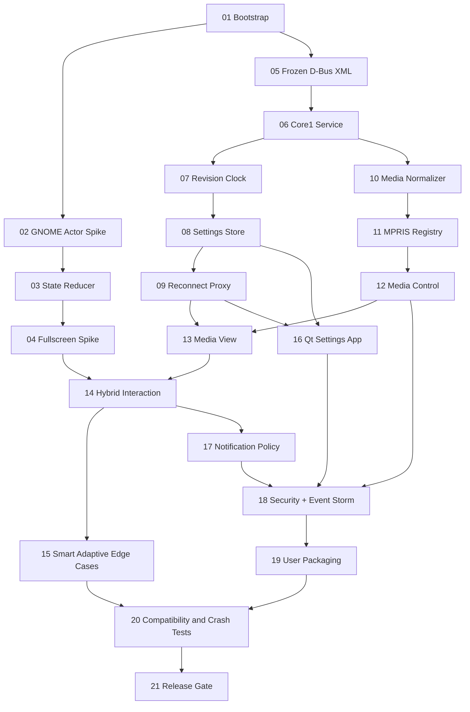

# Linux Island v0.1 Implementation Plan

> **For agentic workers:** REQUIRED SUB-SKILL: Use superpowers:subagent-driven-development (recommended) or superpowers:executing-plans to implement this plan task-by-task. Steps use checkbox (`- [ ]`) syntax for tracking.

**Goal:** Membangun Linux Island v0.1 yang stabil di Ubuntu GNOME Wayland: kapsul Dynamic Mode, Hybrid Interaction, Smart Adaptive, media MPRIS2, settings Qt/QML, notifikasi GNOME yang tidak terduplikasi, dan recovery D-Bus tanpa merusak Shell.

**Architecture:** GNOME Shell Extension (GJS/St/Clutter) memiliki UI state dan rendering. Core C++20/Qt 6 memiliki state data, media MPRIS2, settings, revisi, dan server D-Bus Session Bus. Qt Quick/QML Settings app menggunakan API yang sama. Fitur notifikasi menggunakan GNOME native event dan opt-in hanya setelah pengujian membuktikan tidak ada duplikasi.

**Tech Stack:** C++20, Qt 6 Core/DBus/Quick/Qml/Test, CMake, GNOME Shell 46+ GJS (baseline Ubuntu 24.04 LTS/GNOME 46 yang harus diverifikasi pada host), GLib/Gio, MPRIS2, D-Bus Session Bus, systemd --user, gjs, gdbus, dbus-run-session, ctest.

**Design baseline:** `docs/superpowers/specs/2026-10-24-linux-island-v0.1-design.md` (approved in conversation). D-Bus source schema: `schemas/io.github.linuxisland.Core1.xml`, copied byte-for-byte from approved `Linux_Island_Core1_DBus_Interface.xml` before any implementation. This plan does not claim a repository, code, or passing test currently exists.

**Release scope:** GNOME Wayland, primary monitor, Dynamic display mode. No universal Floating/Integrated mode, no cross-desktop adapters, no full System Monitoring / Quick Settings / File Shelf / Timer / Calendar in v0.1. Product roadmap remains v0.2/v0.3/1.0.

**Execution rules:** Test first, observe red, write smallest implementation, run green, commit each vertical slice. Never run GNOME Shell UI tests in the current personal session without a VM/test user and rollback procedure. No root requirement at runtime; no synchronous D-Bus operations on Shell input path. For commands labeled `EXPECTED`, output is a criterion, not a result already observed.

---

## 0. Decisions, prerequisites and fixed assumptions

1. Obtain host facts before calling release compatible: `lsb_release -ds`, `gnome-shell --version`, `echo "$XDG_SESSION_TYPE"`, `qtpaths6 --version` (if installed). Record actual versions in `docs/compatibility.md`.
2. Proposed first test target: Ubuntu 24.04 LTS + GNOME 46 + Wayland; treat any other GNOME version as a second matrix row rather than silently changing the baseline.
3. Repository root is assumed to be `linux-island/`; paths below are relative to that root. If repo already exists, inspect/adjust the tree before execution. Do not overwrite uncommitted changes.
4. The provisional D-Bus name `io.github.linuxisland.Core` is an API placeholder *identity*, not an implementation task placeholder. Retain exactly through v0.1 testing; switch identity only via a deliberate migration before publishing.
5. Service method signatures and signal names are frozen to the approved XML. The `a{sv}` dictionary is schema version 1; `revision` type is D-Bus `t` (unsigned 64-bit), `positionUs` is `x` (signed 64-bit), `schemaVersion` is `u`.
6. D-Bus Session Bus is not an authorization boundary for same-session applications. Validate every message. Avoid network downloads for artwork by default; do not log notification bodies or media titles.
7. Required capabilities and regression tests map to acceptance IDs AC-01..AC-10 from the design. No claims about performance before measurement.

### Suggested developer dependencies (Ubuntu example)

```bash
sudo apt update
sudo apt install -y build-essential cmake ninja-build pkg-config \
  qt6-base-dev qt6-declarative-dev qt6-tools-dev \
  gjs libglib2.0-bin dbus dbus-user-session \
  gnome-shell-extension-prefs xvfb
```

Package names vary with Ubuntu version. Run `apt-cache policy <package>` before changing a machine; do not install or run these commands as part of document creation. `gnome-shell-extension-prefs` is not essential if unavailable; `gnome-extensions` CLI is the required check.

### Milestone gates (do not proceed past a failed gate)

| Milestone | Tasks | Running software to demonstrate | Gate |
|---|---|---|---|
| M0: GNOME viability | 01-04 | GNOME capsule with locally driven states; fullscreen/cleanup spike | Extension enable/disable and fullscreen safe on baseline |
| M1: Core IPC | 05-09 | Testable Qt D-Bus service + typed schema, atomic settings, reconnection | Contract, failure, and restart tests green |
| M2: Media | 10-13 | MPRIS discovery, player choice/control, metadata in Island | Fake player + real player test; AC-04 |
| M3: UI integration | 14-15 | Full compact/preview/expanded/peek and Smart Adaptive UX | AC-01/02/03/06 and accessibility checks |
| M4: Settings and notification policy | 16-18 | Qt/QML settings; safe notification fallback/opt-in | AC-05/07; no native notification regression |
| M5: Release and quality | 19-21 | user service, packaging, instrumented acceptance | AC-01..AC-10 gates and documented exceptions |

## 1. File map (ownership and purpose)

```text
linux-island/
  CMakeLists.txt                          # project entry, test enablement
  CMakePresets.json                       # reproducible local Debug build
  README.md                               # build, install, architecture, safety
  LICENSE                                 # select before publication (decision gate)
  schemas/io.github.linuxisland.Core1.xml # approved immutable v1 D-Bus signature
  core/CMakeLists.txt                     # Core target and library composition
  core/app/main.cpp                       # QCoreApplication, startup/shutdown
  core/dbus/core_service.h                # business API: state and methods
  core/dbus/core_service.cpp              # handler, snapshot composition
  core/dbus/core_adaptor.h                # QDBusAbstractAdaptor exposing Core1
  core/dbus/core_adaptor.cpp              # delegates, DBus errors, signals
  core/dbus/variant_codec.h               # QVariantMap conversion helpers
  core/dbus/variant_codec.cpp             # exact dictionary types and bounds
  core/media/media_state.h                # immutable normalized data structure
  core/media/media_normalizer.h           # MPRIS property normalization
  core/media/media_normalizer.cpp         # validation, artwork policy, defaults
  core/media/player_registry.h            # discovery and active player selection
  core/media/player_registry.cpp          # NameOwnerChanged, async calls
  core/media/mpris_controller.h           # Media method proxy
  core/media/mpris_controller.cpp         # PlayPause/Next/Previous forwarding
  core/settings/settings_schema.h         # defaults, allowed keys and types
  core/settings/settings_schema.cpp       # pure validation and merge
  core/settings/settings_store.h          # persistence abstraction
  core/settings/settings_store.cpp        # durable writes with rollback
  core/events/revision_clock.h            # revisions/instance ID
  core/events/revision_clock.cpp          # monotonic increments and ownership
  extension/metadata.json                 # shell versions and extension UUID
  extension/extension.js                   # GNOME entry: enable()/disable()
  extension/lib/interactionState.js        # pure state reducer; no Shell imports
  extension/lib/islandController.js        # local state, priority, timers
  extension/lib/coreProxy.js               # async D-Bus client/reconnect
  extension/lib/gnomeDisplayAdapter.js     # GNOME fullscreen and monitor source
  extension/lib/notificationAdapter.js     # safe feasibility/opt-in adapter
  extension/ui/capsule.js                  # St/Clutter actor UI and disposal
  extension/ui/mediaView.js                # media UI with capability flags
  settings-app/CMakeLists.txt              # Qt Quick application target
  settings-app/main.cpp                    # QQmlApplicationEngine and API client
  settings-app/settings_proxy.h            # async Core1 proxy with errors
  settings-app/settings_proxy.cpp          # exposes safe properties to QML
  settings-app/qml/Main.qml                # preferences and status UI
  tests/unit/CMakeLists.txt                # QtTest targets
  tests/unit/tst_settings_schema.cpp       # validation/atomicity specification
  tests/unit/tst_media_normalizer.cpp      # media data and URL policy
  tests/unit/tst_revision_clock.cpp        # instance/revision semantics
  tests/integration/CMakeLists.txt         # sandbox D-Bus tests
  tests/integration/test_schema.py          # XML signature assertion
  tests/integration/tst_core_dbus.cpp       # six methods, three signals, errors
  tests/integration/fake_mpris_player.h     # minimal fake MPRIS interface
  tests/integration/fake_mpris_player.cpp   # exposed properties and event hooks
  tests/integration/tst_mpris_flow.cpp      # discovery/progress/control/race
  tests/extension/state-machine.test.js    # pure GJS state tests
  tests/extension/core-proxy.test.js        # reconnect/state revision tests
  tests/extension/manual-smoke.md          # shell/Wayland acceptance procedure
  tests/security/payload-cases.md          # hostile D-Bus payload suite
  packaging/systemd-user/linux-island-core.service
  packaging/dev/install-local.sh           # user-only install/uninstall instructions
  packaging/dev/uninstall-local.sh
  docs/compatibility.md                    # GNOME + Qt matrix (actual results)
  docs/testing.md                          # runnable validation commands
  docs/release-checklist.md                # AC gates and evidence links
  docs/superpowers/specs/2026-10-24-linux-island-v0.1-design.md
  docs/superpowers/plans/2026-10-24-linux-island-v0.1-implementation.md
```

Use names above consistently. Do not introduce additional services or extra UI toolkits without a design update. A source file can begin small; the responsibility stays narrow.

## 2. Work packages: step-by-step implementation

### Task 01 (M0): repository, CMake and test runner bootstrap

**Files:** Create `CMakeLists.txt`, `CMakePresets.json`, `core/CMakeLists.txt`, `core/app/main.cpp`, `tests/unit/CMakeLists.txt`, `tests/integration/CMakeLists.txt`, `docs/compatibility.md`, `README.md`; copy approved spec to `docs/superpowers/specs/2026-10-24-linux-island-v0.1-design.md`.

- [ ] Step 1: Create fresh working branch/worktree and inspect status: `git status --short; git branch --show-current`; EXPECTED: no unintended changes. If repo does not exist, initialize only after confirming destination.
- [ ] Step 2: Capture baseline `gnome-shell --version`, `echo "$XDG_SESSION_TYPE"`, `cmake --version`, `pkg-config --modversion Qt6Core Qt6DBus Qt6Quick`, and record actual output in `docs/compatibility.md`; EXPECTED: GNOME/Wayland and Qt6 available or a specific prerequisite blocker.
- [ ] Step 3: Write a failing smoke check `test -f CMakePresets.json && test -f core/app/main.cpp && test -f docs/compatibility.md`; EXPECTED: exit 1 until files exist.
- [ ] Step 4: Add minimal build baseline:

```cmake
# CMakeLists.txt
cmake_minimum_required(VERSION 3.22)
project(LinuxIsland VERSION 0.1.0 LANGUAGES CXX)
set(CMAKE_CXX_STANDARD 20)
set(CMAKE_CXX_STANDARD_REQUIRED ON)
find_package(Qt6 REQUIRED COMPONENTS Core DBus Test Quick Qml)
enable_testing()
add_subdirectory(core)
add_subdirectory(tests/unit)
add_subdirectory(tests/integration)
```

```cmake
# core/CMakeLists.txt (bootstrapping only)
add_executable(linux-island-core app/main.cpp)
target_link_libraries(linux-island-core PRIVATE Qt6::Core Qt6::DBus)
```

```cpp
// core/app/main.cpp (bootstrapping only)
#include <QCoreApplication>
int main(int argc, char **argv) {
    QCoreApplication app(argc, argv);
    return app.exec();
}
```

- [ ] Step 5: Add `CMakePresets.json` with configure preset `dev` (`Ninja`, `binaryDir`: `${sourceDir}/build/dev`, `CMAKE_BUILD_TYPE=Debug`) and test preset `dev` (`configurePreset=dev`, `outputOnFailure=true`); keep `tests/*/CMakeLists.txt` valid even before test targets exist.
- [ ] Step 6: Run `cmake --preset dev && cmake --build build/dev && ctest --test-dir build/dev --output-on-failure`; EXPECTED: configure/build successful; no tests yet is permissible only in this bootstrap task.
- [ ] Step 7: Commit `chore: scaffold Linux Island CMake and environment baseline`.

### Task 02 (M0): GNOME actor feasibility and clean enable/disable

**Files:** Create `extension/metadata.json`, `extension/extension.js`, `extension/ui/capsule.js`, `tests/extension/manual-smoke.md`.

- [ ] Step 1: In an isolated GNOME test user/VM, capture GNOME Shell version and create a manual red test: install extension, enable twice, disable twice, and inspect journal. EXPECTED: FAIL because the extension does not exist.
- [ ] Step 2: Create metadata using UUID `linux-island@local` and GNOME `shell-version: ["46"]` for the confirmed baseline; add `name`, `description`, and target `url` only if real.
- [ ] Step 3: Implement extension entry with GNOME 45+ ESM `Extension` lifecycle. Minimal valid pattern:

```js
import {Extension} from 'resource:///org/gnome/shell/extensions/extension.js';
import {Capsule} from './ui/capsule.js';
export default class LinuxIslandExtension extends Extension {
    enable() { this._capsule = new Capsule(); this._capsule.mount(); }
    disable() { this._capsule?.destroy(); this._capsule = null; }
}
```

- [ ] Step 4: Implement `Capsule` in `extension/ui/capsule.js` using `PanelMenu.Button` containing `St.BoxLayout`/`St.Label`, registered with `Main.panel.addToStatusArea()` on GNOME 46; constructor creates only necessary actors; `destroy()` removes actors and signals owned by this instance. If status-area placement cannot meet center/capsule geometry, document alternative supported location and obtain UI design sign-off before changing mode behavior.
- [ ] Step 5: Implement the first capsule adapter as a complete, dispose-safe Shell object (then expand appearance after the feasibility gate):

```js
// extension/ui/capsule.js (minimal GNOME 46 spike)
import * as Main from 'resource:///org/gnome/shell/ui/main.js';
import * as PanelMenu from 'resource:///org/gnome/shell/ui/panelMenu.js';
import St from 'gi://St';
import Clutter from 'gi://Clutter';
export class Capsule {
    constructor() {
        this._button = new PanelMenu.Button(0, 'Linux Island', false);
        this._button.add_child(new St.Label({
            text: 'Island', y_align: Clutter.ActorAlign.CENTER,
        }));
    }
    mount() { Main.panel.addToStatusArea('linux-island', this._button, 0, 'center'); }
    destroy() { this._button?.destroy(); this._button = null; }
}
```

- [ ] Step 6: Install to `$HOME/.local/share/gnome-shell/extensions/linux-island@local`, run `gnome-extensions enable linux-island@local`, `gnome-extensions info linux-island@local`, `gnome-extensions disable linux-island@local`; EXPECTED: actor appears/disappears without duplicate actor or Shell crash. Use the GNOME extension app/relogin as required by GNOME Wayland for newly installed extensions.
- [ ] Step 7: Repeat enable/disable 10 times; monitor `journalctl --user -b | grep -Ei 'linux.island|gnome.shell'` for regressions (do not assume every unrelated journal entry is caused by extension).
- [ ] Step 8: Commit `feat(gnome): add lifecycle-safe capsule proof of concept`.

### Task 03 (M0): pure interaction reducer and context-aware priority

**Files:** Create `extension/lib/interactionState.js`, `tests/extension/state-machine.test.js`; modify `extension/lib/islandController.js` when introduced.

- [ ] Step 1: Create failing GJS test that imports pure reducer without Shell dependencies:

```js
import {transition} from '../../extension/lib/interactionState.js';
function eq(actual, expected) { if (actual !== expected) throw Error(`${actual} != ${expected}`); }
eq(transition('COMPACT', 'HOVER_ENTER'), 'PREVIEW');
eq(transition('PREVIEW', 'CLICK'), 'EXPANDED');
eq(transition('EXPANDED', 'PEEK_REQUEST'), 'EXPANDED');
eq(transition('EXPANDED', 'FULLSCREEN_ON'), 'HIDDEN');
eq(transition('HIDDEN', 'FULLSCREEN_OFF'), 'COMPACT');
```

- [ ] Step 2: Run `gjs -m tests/extension/state-machine.test.js`; EXPECTED: FAIL because reducer is missing.
- [ ] Step 3: Implement first red cases in `extension/lib/interactionState.js`:

```js
const STATES = new Set(['HIDDEN', 'COMPACT', 'PREVIEW', 'EXPANDED', 'PEEK']);
export function transition(current, event) {
    if (!STATES.has(current)) throw new Error('Invalid state');
    if (event === 'FULLSCREEN_ON') return 'HIDDEN';
    if (current === 'HIDDEN') return event === 'FULLSCREEN_OFF' ? 'COMPACT' : 'HIDDEN';
    if (current === 'EXPANDED' && event === 'PEEK_REQUEST') return current;
    if (event === 'CLICK' && (current === 'COMPACT' || current === 'PREVIEW')) return 'EXPANDED';
    if (event === 'DISMISS' && current === 'EXPANDED') return 'COMPACT';
    if (event === 'HOVER_ENTER' && current === 'COMPACT') return 'PREVIEW';
    if (event === 'HOVER_LEAVE' && current === 'PREVIEW') return 'COMPACT';
    if (event === 'PEEK_REQUEST' && current === 'COMPACT') return 'PEEK';
    if (event === 'PEEK_TIMEOUT' && current === 'PEEK') return 'COMPACT';
    return current;
}
```

- [ ] Step 4: Expand tests for repeated/fullscreen events, Escape alias of dismiss, and stale timeout (a `PEEK_TIMEOUT` after expanding must leave EXPANDED untouched). Use test-controlled timer scheduler in `IslandController`, never raw timers inside reducer.
- [ ] Step 5: Run `gjs -m tests/extension/state-machine.test.js`; EXPECTED: PASS for all asserted state transitions.
- [ ] Step 6: Commit `test(gnome): define five-state context-aware reducer`.

### Task 04 (M0): GNOME fullscreen + cleanup compatibility spike

**Files:** Create `extension/lib/gnomeDisplayAdapter.js`, `extension/lib/islandController.js`; modify `extension/extension.js`, `tests/extension/manual-smoke.md`.

- [ ] Step 1: Add red manual scenarios: fullscreen a video/game-like window on primary monitor, leave fullscreen, switch workspace, disable extension while EXPANDED, and re-enable. EXPECTED: missing adapter causes failed acceptance.
- [ ] Step 2: Implement `GnomeDisplayAdapter` with a `subscribe(onChange)` interface and `destroy()`. Use GNOME 46 `global.display`/`global.workspace_manager` events and `Meta.Window` fullscreen state as supported by the target version, recomputing only on relevant events (not sub-100ms polling). Determine monitor index from primary monitor and verify on real GNOME; avoid guessing private Shell property names.
- [ ] Step 3: Have `IslandController` translate fullscreen on/off into `transition()` events; hide actor in HIDDEN and restore COMPACT without replaying old peek events.
- [ ] Step 4: Add bounded timeout management for hover leave and PEEK. Store timeout IDs and cancel them on disable and state change; ensure no callback touches a destroyed actor.
- [ ] Step 5: Run manual smoke suite in a VM/test user with both fullscreen and normal windows; EXPECTED: AC-06 passes or the exact unverified GNOME API is documented as blocker. Do not claim fullscreen support on an untested GNOME version.
- [ ] Step 6: Commit `feat(gnome): add Smart Adaptive fullscreen and safe lifecycle`.

### Task 05 (M1): pin introspection XML and test schema stability

**Files:** Create `schemas/io.github.linuxisland.Core1.xml`, `tests/integration/test_schema.py`, `tests/integration/CMakeLists.txt` modifications.

- [ ] Step 1: Copy the approved XML exactly, including 6 methods (`GetSnapshot`, `GetMediaState`, `ControlMedia`, `SetActivePlayer`, `GetSettings`, `UpdateSettings`) and 3 signals (`MediaChanged`, `SettingsChanged`, `CoreStatusChanged`). Do not add an incompatible method signature while keeping `Core1`.
- [ ] Step 2: Write a failing standard-library Python XML test:

```python
# tests/integration/test_schema.py
from pathlib import Path
import xml.etree.ElementTree as ET
root = ET.parse(Path('schemas/io.github.linuxisland.Core1.xml')).getroot()
iface = root.find("interface[@name='io.github.linuxisland.Core1']")
assert iface is not None
assert {x.attrib['name'] for x in iface.findall('method')} == {
    'GetSnapshot', 'GetMediaState', 'ControlMedia', 'SetActivePlayer', 'GetSettings', 'UpdateSettings'}
assert {x.attrib['name'] for x in iface.findall('signal')} == {
    'MediaChanged', 'SettingsChanged', 'CoreStatusChanged'}
```

- [ ] Step 3: Run `python3 tests/integration/test_schema.py`; EXPECTED: FAIL before copied XML, PASS afterward. Also run `xmllint --noout schemas/io.github.linuxisland.Core1.xml` if xmllint is installed.
- [ ] Step 4: Integrate test through `add_test(NAME dbus-schema COMMAND ${Python3_EXECUTABLE} ... )` after `find_package(Python3 REQUIRED COMPONENTS Interpreter)`, with the repository root as working directory; ensure `ctest --test-dir build/dev -R dbus-schema --output-on-failure` passes.
- [ ] Step 5: Commit `test(ipc): freeze Core1 introspection schema`.

### Task 06 (M1): Qt Core service, name ownership and initial snapshot

**Files:** Create `core/dbus/core_service.h`, `.cpp`, `core/dbus/core_adaptor.h`, `.cpp`, `core/dbus/variant_codec.h`, `.cpp`; modify `core/app/main.cpp`, `core/CMakeLists.txt`, `tests/integration/tst_core_dbus.cpp`.

- [ ] Step 1: Add a failing Qt Test that launches Core on a private session bus and calls `GetSnapshot` via `QDBusInterface`; EXPECTED: `io.github.linuxisland.Core` does not exist. Test fixture must use `dbus-run-session`, not a developer's personal session bus.
- [ ] Step 2: Add `CoreService : QObject` owning `QVariantMap snapshot() const` and a `QDBusAbstractAdaptor` with `Q_CLASSINFO("D-Bus Interface", "io.github.linuxisland.Core1")`. For `GetSnapshot`, use `QDBusVariant`/registered `QVariantMap` serialization and verify introspection reports `a{sv}` exactly, not `a{ss}` or an opaque untyped variant.
- [ ] Step 3: Register object and bus name in `main.cpp` (failure must exit nonzero):

```cpp
const auto bus = QDBusConnection::sessionBus();
if (!bus.registerObject("/io/github/linuxisland/Core", &service,
                        QDBusConnection::ExportAdaptors) ||
    !bus.registerService("io.github.linuxisland.Core")) {
    qCritical() << "Cannot register Linux Island Core D-Bus service";
    return 1;
}
```

- [ ] Step 4: Populate snapshot using exact keys `schemaVersion`, `instanceId`, `status`, `mediaRevision`, `settingsRevision`, `media`, `settings`, `capabilities`. Use `QDBusVariant`/`QVariantMap` properly and establish defaults for no player.
- [ ] Step 5: Run inside private bus: `dbus-run-session -- sh -c './build/dev/core/linux-island-core & pid=$!; sleep 1; gdbus introspect --session --dest io.github.linuxisland.Core --object-path /io/github/linuxisland/Core; kill "$pid"; wait "$pid"'`. EXPECTED: all 6 methods, 3 signals and correct types (stubs may return `NotReady` until later tasks). Do not assert success from merely compiling the adaptor.
- [ ] Step 6: Test second Core cannot claim the same name, and first Core exits cleanly; run `ctest --test-dir build/dev -R core-dbus --output-on-failure` after registering test target.
- [ ] Step 7: Commit `feat(core): expose versioned Core1 D-Bus service`.

### Task 07 (M1): monotonic revision and restart identity

**Files:** Create `core/events/revision_clock.h`, `.cpp`, `tests/unit/tst_revision_clock.cpp`; modify `core/dbus/core_service.cpp`.

- [ ] Step 1: Write failing Qt test with `RevisionClock clock; QCOMPARE(clock.mediaRevision(), quint64(0)); clock.mediaChanged(); QCOMPARE(clock.mediaRevision(), quint64(1));` and a new clock whose `instanceId()` differs.
- [ ] Step 2: Run `ctest --test-dir build/dev -R revision-clock --output-on-failure`; EXPECTED: FAIL with missing implementation.
- [ ] Step 3: Implement immutable per-process UUID (`QUuid::createUuid().toString(QUuid::WithoutBraces)`), two monotonic `quint64` counters, increment functions, and overflow behavior (explicit rejection rather than wrap). Never persist instance ID between process restarts.
- [ ] Step 4: Wire revisions into `GetSnapshot`, `MediaChanged`, `SettingsChanged`; ensure events only increment on effective state change.
- [ ] Step 5: Add snapshot restart integration test: Core PID restart produces different instance ID; caller invalidates both revision caches even when revision values decrease.
- [ ] Step 6: Run unit and D-Bus tests; EXPECTED: PASS; commit `feat(core): add per-instance revision tracking`.

### Task 08 (M1): settings schema, validation and atomic persistence

**Files:** Create `core/settings/settings_schema.h`, `.cpp`, `core/settings/settings_store.h`, `.cpp`, `tests/unit/tst_settings_schema.cpp`; modify `core/dbus/core_service.cpp`, `core/dbus/core_adaptor.cpp`.

- [ ] Step 1: Add failing Qt Test for valid updates, unknown key, wrong QVariant type, invalid enum, empty string, overlong preferredPlayerId, persistence failure, and all-or-nothing merge. Example:

```cpp
QVariantMap changes{{"theme", "dark"}, {"capsuleSize", "huge"}};
const auto outcome = validateSettingsPatch(defaultSettings(), changes);
QVERIFY(!outcome.ok);
QCOMPARE(outcome.effective.value("theme").toString(), QString("system"));
```

- [ ] Step 2: Run `ctest --test-dir build/dev -R settings-schema --output-on-failure`; EXPECTED: FAIL before implementation.
- [ ] Step 3: Implement pure `defaultSettings()` and `validateSettingsPatch(current, patch)` for exactly 8 keys from spec: `theme`, `capsuleSize`, `animationEnabled`, `hoverPreviewEnabled`, `notificationPeekEnabled`, `smartAdaptiveEnabled`, `preferredPlayerId`, `displayMode`. Allowed values: theme `system|light|dark`, capsule size `small|medium|large`, displayMode only `dynamic`. Reject unsupported key/DBus type and oversized strings (e.g. 256 bytes for player ID); enforce effective reduced-motion externally in Extension.
- [ ] Step 4: Implement `SettingsStore` with write-to-temporary file, fsync/atomic rename or equivalent verified durable strategy under `$XDG_CONFIG_HOME/linux-island/`, then apply new in-memory state only after storage succeeds. `QSettings::sync()` alone is not a transaction across all updates: explicitly test atomic rollback and avoid claiming atomicity solely because Qt wrote an INI file.
- [ ] Step 5: Wire `GetSettings` and `UpdateSettings` returning `settingsRevision:t`; use `QDBusError` reply with fully-qualified `io.github.linuxisland.Error.InvalidArgument` / `SettingsWriteFailed` on failure; `SettingsChanged` only after persisted effective change.
- [ ] Step 6: Run unit/integration tests in isolated XDG config directory (`XDG_CONFIG_HOME=$(mktemp -d) ...`); EXPECTED: invalid mixed patch leaves old file and state unchanged; valid patch persists after Core restart.
- [ ] Step 7: Commit `feat(settings): validate and atomically persist Core1 settings`.

### Task 09 (M1): async CoreProxy reconnect protocol in GJS

**Files:** Create `extension/lib/coreProxy.js`, `tests/extension/core-proxy.test.js`; modify `extension/extension.js`.

- [ ] Step 1: Write a failing GJS test that simulates `owner=':1.20' -> null -> ':1.21'`, with snapshot revisions `5 -> 0`: test must reset cached state and accept the new instance. Keep the revision reducer separate from actual GNOME-only APIs to run using `gjs -m`.
- [ ] Step 2: Run `gjs -m tests/extension/core-proxy.test.js`; EXPECTED: FAIL before implementation.
- [ ] Step 3: Implement a `CoreProxy` class wrapping `Gio.DBusProxy.new_for_bus()` asynchronously; connect to `notify::g-name-owner` and `g-signal`, then call `GetSnapshot` asynchronously. Use `Gio.Cancellable` bound to Extension lifecycle; never block GNOME Shell main thread with `call_sync()`.
- [ ] Step 4: Define bootstrap ordering: attach signal handlers first, fetch snapshot, compare `instanceId` plus revisions, resnapshot if signals raced with bootstrap. A signal is discarded only when `instanceId` matches and revision is not newer.
- [ ] Step 5: Implement `destroy()` that cancels pending calls and disconnects all handlers; when name owner disappears, reset `media` to no-player, disable controls, and allow local capsule state to continue.
- [ ] Step 6: Run GJS test and manually kill/restart Core five times; EXPECTED: no stale metadata, no Shell freeze; a restarted Core is recognized by new instance ID.
- [ ] Step 7: Commit `feat(gnome): reconnect-safe async Core1 proxy`.

### Task 10 (M2): normalized media state and safe album-art policy

**Files:** Create `core/media/media_state.h`, `core/media/media_normalizer.h`, `.cpp`, `tests/unit/tst_media_normalizer.cpp`; modify `core/dbus/variant_codec.cpp`.

- [ ] Step 1: Write failing tests for no player, empty title, `xesam:artist` list, `mpris:length` as `qlonglong`, negative durations, invalid rate, artwork `https://` URI, unknown URI schemes, huge metadata strings, and valid playback enums. EXPECTED: tests fail because converter does not exist.
- [ ] Step 2: Define a `MediaState` structure with `QString playerId, title, artist, albumArtUri, playbackStatus; qint64 positionUs, durationUs; bool canPlay, canPause, canNext, canPrevious, canSeek; double rate; quint64 revision`. Normalize bounded strings (e.g. title/artist <= 2048 UTF-8 bytes), nonnegative microseconds, `rate>0`, and default `Stopped` when unknown.
- [ ] Step 3: Implement `normalizeMpris(const QString &service, const QVariantMap &metadata, const QVariantMap &properties)` that reads `xesam:title`, `xesam:artist`, `mpris:artUrl`, `mpris:length`, and relevant MPRIS player properties. `CanGoNext` maps to `canNext`, `CanGoPrevious` maps to `canPrevious`. Missing/incorrect types must not crash Core.
- [ ] Step 4: Enforce artwork policy: initially allow `file://` only when resolved path passes a safe policy for local user-owned files, with size cap; prefer placeholder for remote/unsupported URIs. Do not trigger HTTP requests in GNOME Shell. If file policy cannot be proved safe, use placeholder for all artwork in v0.1.
- [ ] Step 5: Expose `toMediaVariantMap(const MediaState&)` using spec keys and exact numerical types (`qint64` for times, `quint64` revision); write tests that round-trip a sample over an isolated D-Bus call rather than relying on QVariant type assumptions.
- [ ] Step 6: Run `ctest --test-dir build/dev -R media-normalizer --output-on-failure`; EXPECTED: all edge cases PASS. Commit `feat(media): normalize MPRIS state with bounded metadata`.

### Task 11 (M2): asynchronous MPRIS service discovery and active-player selection

**Files:** Create `core/media/player_registry.h`, `.cpp`, `tests/integration/fake_mpris_player.h`, `.cpp`, `tests/integration/tst_mpris_flow.cpp`; modify `core/dbus/core_service.cpp`.

- [ ] Step 1: Build a fake player exposing `org.mpris.MediaPlayer2` + `org.mpris.MediaPlayer2.Player` at `/org/mpris/MediaPlayer2` under `org.mpris.MediaPlayer2.LinuxIslandFake` on a private D-Bus session. Its `PlaybackStatus`, `Metadata`, capability properties and `PropertiesChanged` must be controllable by tests.
- [ ] Step 2: Add failing integration tests: zero players -> empty media; one player -> selected; two players -> prefer saved service if present; else first `Playing`; else sorted service name. Test owner vanishes while switching players.
- [ ] Step 3: Implement discovery via `org.freedesktop.DBus.ListNames` plus `NameOwnerChanged` subscription, filtering `org.mpris.MediaPlayer2.*`. Read player properties with asynchronous `GetAll`; never block Core event loop on a service that fails or delays.
- [ ] Step 4: Implement selection policy as pure function `chooseActivePlayer(players, preferredId)` and test with identical inputs. Do not store a raw transient D-Bus owner name as user-facing `playerId`; use stable service name while player exists.
- [ ] Step 5: Subscribe to MPRIS `PropertiesChanged` and `Seeked`; debounce bursts into one normalized state update; ensure `MediaChanged` revision increments only for effective changes.
- [ ] Step 6: Run `dbus-run-session -- ctest --test-dir build/dev -R mpris-flow --output-on-failure`; EXPECTED: selection, disappearance, and race cases PASS. Commit `feat(media): discover and select MPRIS players`.

### Task 12 (M2): MPRIS control methods and Core1 error semantics

**Files:** Create `core/media/mpris_controller.h`, `.cpp`; modify `core/dbus/core_adaptor.cpp`, `core/dbus/core_service.cpp`, `tests/integration/tst_mpris_flow.cpp`, `tests/integration/tst_core_dbus.cpp`.

- [ ] Step 1: Write failing tests: valid PlayPause/Next/Previous reaches fake player once; unknown action -> `io.github.linuxisland.Error.UnsupportedAction`; missing player -> `PlayerUnavailable`; invalid `SetActivePlayer` -> `InvalidArgument` or `PlayerUnavailable` depending on failure.
- [ ] Step 2: Implement `MprisController::perform(action, playerId)` with whitelist exactly `PlayPause`, `Next`, `Previous`; map to MPRIS Player methods, verify relevant capabilities before forwarding, and use asynchronous `QDBusPendingCallWatcher` or equivalent.
- [ ] Step 3: For synchronous Core1 method return signature `accepted:b`, document exact semantics: `true` means request validated and dispatched, NOT that player transition is confirmed; failures to dispatch must be returned as named D-Bus errors. Do not return `false` in place of error for the specified error conditions.
- [ ] Step 4: Implement `SetActivePlayer` against known stable service IDs only, cap input length, reject arbitrary bus names and stale IDs; update `preferredPlayerId` only through Settings API if durable preference is intended. Ensure method changes active selection but does not silently write persistent setting contrary to contract.
- [ ] Step 5: Run `dbus-run-session -- ctest --test-dir build/dev -R '(core-dbus|mpris-flow)' --output-on-failure`; EXPECTED: correct D-Bus errors, no duplicate media actions after retry, and signals only after observed player data changes.
- [ ] Step 6: Commit `feat(media): add validated media controls and Core1 errors`.

### Task 13 (M2): snapshot-driven media UI and progress display

**Files:** Create `extension/ui/mediaView.js`; modify `extension/ui/capsule.js`, `extension/lib/coreProxy.js`, `extension/lib/islandController.js`, `tests/extension/manual-smoke.md`.

- [ ] Step 1: Add red manual tests: fake player starts Playing, track metadata changes, becomes Paused, disappears, Core restarts; read-only player has disabled control; expected UI never shows stale active controls.
- [ ] Step 2: Implement `MediaView.setMedia(media)` as a pure input-driven presentation adapter: escape/normalize text labels via St widgets (never markup interpolation), show safe icon/placeholder, only enable controls supported by `canPlay`/`canPause`/`canNext`/`canPrevious`.
- [ ] Step 3: Hook click handlers to CoreProxy's asynchronous `ControlMedia` action; suppress rapid duplicate user clicks while request in flight with bounded timeout; reject an action if CoreProxy has no name owner.
- [ ] Step 4: Estimate progress from last `positionUs`, playbackStatus, `rate`, and monotonic clock; update visual at a moderate interval only while progress is visible. Resync on `Seeked`, track changes, or panel opening. Do not falsely assume Position changes emit PropertiesChanged continuously.
- [ ] Step 5: Test with fake player and one actual MPRIS-capable player on baseline GNOME. EXPECTED: AC-04 covers title, artist, status, PlayPause, Next, Previous and no player fallback. Record unsupported real apps explicitly.
- [ ] Step 6: Commit `feat(gnome): bind Island media view to Core1`.

### Task 14 (M3): finalize Island interaction, accessibility and theme-independent rendering

**Files:** Modify `extension/ui/capsule.js`, `extension/ui/mediaView.js`, `extension/lib/islandController.js`, `extension/lib/interactionState.js`, `tests/extension/state-machine.test.js`, `tests/extension/manual-smoke.md`.

- [ ] Step 1: Add failing reducer tests for queued PEEK during hover, event after fullscreen, simultaneous fullscreen and click, rapid repeated hover leave/enter, and no event replay after HIDDEN -> COMPACT.
- [ ] Step 2: Wire controller with COMPACT, PREVIEW, EXPANDED, PEEK, HIDDEN and one animation owner. On transition cancel any prior tween before scheduling a new one; use Clutter animations non-blocking; avoid expensive frame-time property introspection.
- [ ] Step 3: Implement on-shell hover preview, click full panel, Escape/click-outside dismiss using only Shell-supported event propagation; do not install global key grabs or global click interception. Define behavior when modal prompt/overview is active and test that input reaches original windows normally.
- [ ] Step 4: Add accessibility: labelled media buttons, keyboard focus, `Escape` dismissal, reduced motion policy (disable/shorten animation if system preference available), and safe contrast in light and dark modes. Use an accessible GNOME actor approach verified on target Shell; do not assume generic Qt accessibility APIs apply to GJS actors.
- [ ] Step 5: Execute `gjs -m tests/extension/state-machine.test.js` and GNOME manual AC-01/02/03. EXPECTED: all transitions deterministic and no loss of focus or lingering actor after disable.
- [ ] Step 6: Commit `feat(gnome): complete hybrid interaction and accessible states`.

### Task 15 (M3): Smart Adaptive edge cases and UX safety gates

**Files:** Modify `extension/lib/gnomeDisplayAdapter.js`, `extension/lib/islandController.js`, `tests/extension/manual-smoke.md`, `docs/compatibility.md`.

- [ ] Step 1: Extend manual red matrix to fullscreen on primary monitor, maximized non-fullscreen, window behind another window, app switching while fullscreen, lock screen, overview, Shell restart, and removal of a connected secondary monitor.
- [ ] Step 2: Define `isFullscreenOnPrimaryMonitor()` adapter behavior and verify GNOME 46 APIs in a disposable session; count a fullscreen window only if it matches visibility/monitor policy. Do not mistake a maximized window for fullscreen.
- [ ] Step 3: Ensure fullscreen has higher priority than active panel or pending peek; when fullscreen ends return to COMPACT and discard stale timers. When GNOME API unavailable, enter conservative non-obstructive mode and record adapter capability failure.
- [ ] Step 4: Run acceptance for AC-06 and regression AC-01/03; EXPECTED: Island never obstructs tested fullscreen content; document each observed case in `docs/compatibility.md` with GNOME version and date.
- [ ] Step 5: Commit `fix(gnome): harden Smart Adaptive behavior`.

### Task 16 (M4): settings Qt/QML client and live theme/size updates

**Files:** Create `settings-app/CMakeLists.txt`, `settings-app/main.cpp`, `settings-app/settings_proxy.h`, `.cpp`, `settings-app/qml/Main.qml`; modify `CMakeLists.txt`, `extension/lib/coreProxy.js`, `extension/ui/capsule.js`, `tests/integration/tst_core_dbus.cpp`.

- [ ] Step 1: Add red integration tests for GetSettings defaults, successful UpdateSettings revision, atomic reject of invalid patch, and SettingsChanged observation by a second client.
- [ ] Step 2: Create `linux-island-settings` using `QGuiApplication`, `QQmlApplicationEngine`, and C++ `SettingsProxy` QObject with Q_PROPERTY `theme`, `capsuleSize`, `busy`, `errorMessage` and `Q_INVOKABLE` setters. Use `QDBusPendingCallWatcher` (not blocking `QDBusInterface::call`) to read/write Core1 asynchronously.
- [ ] Step 3: Implement minimal QML form: theme choice `system/light/dark`, size `small/medium/large`, toggles for animation/hover/Smart Adaptive/notificationPeek, preferred media player, and connection status. Disable unsupported display modes; show valid error text when Core is offline.
- [ ] Step 4: On success use returned revision/signal or refresh `GetSettings` to show committed values. On failure restore last persisted value and display a non-sensitive error. Do not treat optimistic UI value as persistent success.
- [ ] Step 5: Extension applies `SettingsChanged` without restarting Shell; preserve local interaction state unless a setting specifically requires recalculating geometry. Test system-theme changes and reduced motion; notificationPeek remains default false.
- [ ] Step 6: Run `cmake --build build/dev --target linux-island-settings`, `dbus-run-session -- ctest --test-dir build/dev -R core-dbus --output-on-failure`, and manual AC-07; EXPECTED: Qt Quick app launches on GNOME session with Core running, and changes survive Core restart.
- [ ] Step 7: Commit `feat(settings): ship Qt Quick preferences with live sync`.

### Task 17 (M4): GNOME notification compatibility spike and native fallback

**Files:** Create `extension/lib/notificationAdapter.js`; modify `extension/lib/islandController.js`, `extension/extension.js`, `tests/extension/manual-smoke.md`, `docs/compatibility.md`.

- [ ] Step 1: Add manual red test matrix for GNOME native notification while extension off/on, DND enabled/disabled, fullscreen on/off, multiple simultaneous notifications, and privacy text. Expected baseline: native GNOME notifications still function.
- [ ] Step 2: Prototype observing supported GNOME Shell notification events through *version-specific* GNOME-owned APIs; do NOT claim `org.freedesktop.Notifications` service name, replace GNOME daemon, or snoop entire bus. Gate the adapter on tested compatibility version and `notificationPeekEnabled` setting.
- [ ] Step 3: If native notification and Island PEEK would duplicate visual popups, leave Island peek OFF; keep GNOME notification unchanged. If a non-duplicating rendering path is confirmed, add PEEK with explicit timeout and suppression of content logging; never bypass DND/fullscreen policy.
- [ ] Step 4: When adapter detects version/API incompatibility, disconnect hook, report limited `capability` locally, and keep notificationPeek effectively disabled. Do not turn a notification integration failure into a Core or Shell crash.
- [ ] Step 5: Run manual AC-05 tests, record GNOME version and whether Island PEEK is supported/disabled. EXPECTED: native notifications never disappear or duplicate. Passing this fallback counts as MVP-compatible; notification peek is not a required release gate.
- [ ] Step 6: Commit `feat(gnome): add guarded notifications with native fallback`.

### Task 18 (M4): validate D-Bus input, URI and event-storm boundaries

**Files:** Modify `core/dbus/variant_codec.cpp`, `core/settings/settings_schema.cpp`, `core/media/media_normalizer.cpp`, `extension/lib/coreProxy.js`; create `tests/security/payload-cases.md`; modify `tests/integration/tst_core_dbus.cpp`.

- [ ] Step 1: Add red tests for malformed/big `a{sv}` maps, long strings, wrong numeric types, NaN/inf playback rate, arbitrary `ControlMedia` text, unexpected player IDs, unsupported settings, and repeated rapid updates; document each exact case in `tests/security/payload-cases.md`.
- [ ] Step 2: Enforce explicit per-field bounds and whole-map limit (initial proposal: 32 setting entries, 16 KiB serialized settings payload; refine only if measured normal payload requires more). Reject invalid inputs with `InvalidArgument`, not silent coercion.
- [ ] Step 3: Ensure no user-originated values become shell command, unvalidated arbitrary file path, dynamically evaluated JS, or remote artwork fetch. Check logs contain only event type, revision, and redacted error class.
- [ ] Step 4: Coalesce event storms: for repeated equivalent media state changes don't increment revisions or emit duplicate `MediaChanged`; throttle noncritical UI updates and cancel obsolete async replies when owner changes.
- [ ] Step 5: Execute security/integration tests on a private D-Bus session; EXPECTED: no Core crash, memory blowup, or Shell freeze under capped test inputs. Commit `test(security): harden bus payload and event boundaries`.

### Task 19 (M5): user-level service, developer install/uninstall

**Files:** Create `packaging/systemd-user/linux-island-core.service`, `packaging/dev/install-local.sh`, `packaging/dev/uninstall-local.sh`; modify `README.md`, `docs/testing.md`.

- [ ] Step 1: Create red smoke checks for user service existence and install path. EXPECTED: `systemctl --user status linux-island-core.service` initially reports no unit.
- [ ] Step 2: Write user service template:

```ini
[Unit]
Description=Linux Island Core
After=graphical-session.target
StartLimitIntervalSec=60
StartLimitBurst=5

[Service]
Type=dbus
BusName=io.github.linuxisland.Core
ExecStart=%h/.local/libexec/linux-island-core
Restart=on-failure
RestartSec=2

[Install]
WantedBy=default.target
```

- [ ] Step 3: Verify `StartLimitIntervalSec=60` and `StartLimitBurst=5` are under `[Unit]`, not `[Service]`. Test `systemd-analyze verify packaging/systemd-user/linux-island-core.service` (or user equivalent) and ensure `ExecStart` absolute runtime path matches installed binary.
- [ ] Step 4: `install-local.sh` must install Core to `$HOME/.local/libexec`, unit to `$HOME/.config/systemd/user`, GNOME extension to `$HOME/.local/share/gnome-shell/extensions/linux-island@local`, and settings executable to `$HOME/.local/bin`; reload user daemon. Do not overwrite existing versions without backup or prompt. No `sudo` inside install scripts.
- [ ] Step 5: `uninstall-local.sh` must disable extension, stop/disable unit, remove only paths owned by installation, and preserve user's settings unless explicitly requested.
- [ ] Step 6: On a disposable GNOME test user, install, enable service + extension, log out/in, uninstall. EXPECTED: no orphan process, no residual enabled extension or stale unit; retained settings clearly documented.
- [ ] Step 7: Commit `build: add reversible user-level packaging`.

### Task 20 (M5): reproducible integration, compatibility and crash testing

**Files:** Modify `tests/integration/CMakeLists.txt`, `tests/integration/tst_core_dbus.cpp`, `tests/integration/tst_mpris_flow.cpp`, `tests/extension/core-proxy.test.js`, `tests/extension/manual-smoke.md`, `docs/testing.md`, `docs/compatibility.md`.

- [ ] Step 1: Create a single test recipe that configures/builds and runs `ctest` with a private session bus (`dbus-run-session`), plus pure GJS tests using `gjs -m`. Ensure test helpers terminate fake Core/MPRIS processes after every case.
- [ ] Step 2: Assert all Core1 method names, arg directions and signatures via actual D-Bus introspection, not just XML static parsing; test 3 signals and exact named error suffixes.
- [ ] Step 3: Create repeatable failure injection: kill -9 Core during GetSnapshot; restart Core with a new instance; disconnect fake MPRIS during pending call; force unreadable settings location; disable Extension during active timeout; fullscreen during EXPANDED. Verify no stale view and clean recovery.
- [ ] Step 4: Test two Core processes competing for one bus name; verify only one owner and installer cannot accidentally register system bus names. Confirm no root privilege required at runtime.
- [ ] Step 5: Run GNOME enable/disable 20 cycles on baseline VM; compare Shell diagnostics and extension actor count before/after. EXPECTED: zero leaked Island actors/listeners, no Shell crashes attributable to extension.
- [ ] Step 6: Record results with actual GNOME version, Qt version, session type, hardware, and build commit in `docs/compatibility.md`. Do not write PASS for unexecuted scenarios.
- [ ] Step 7: Commit `test: add IPC recovery and GNOME compatibility matrix`.

### Task 21 (M5): release gate, performance measurement and documentation

**Files:** Create `docs/release-checklist.md`; modify `README.md`, `docs/testing.md`, `docs/compatibility.md`; add `LICENSE` only after license decision.

- [ ] Step 1: Run `cmake --preset dev && cmake --build build/dev && ctest --test-dir build/dev --output-on-failure`. EXPECTED: zero failing automated tests; capture counts/versions from real run.
- [ ] Step 2: Run pure GJS tests: `gjs -m tests/extension/state-machine.test.js` and `gjs -m tests/extension/core-proxy.test.js`. EXPECTED: zero uncaught exceptions.
- [ ] Step 3: Complete AC-01 through AC-09 in `tests/extension/manual-smoke.md` on Ubuntu GNOME Wayland. AC-05 passes if GNOME notifications remain native and nonduplicate, even when Island PEEK is disabled. AC-01..04 and AC-06..09 require actual PASS before tagging.
- [ ] Step 4: Measure AC-10: record CPU/RSS of Core idle and while media changes, Shell frame behavior while animating, 95th-percentile hover-to-preview latency, and event coalescing under burst. Establish measurable thresholds from a recorded baseline rather than inventing benchmark figures.
- [ ] Step 5: Check docs for start/stop, permissions, troubleshooting, service management, remove/reinstall, GNOME compatibility, known limitations, privacy (no telemetry by default), and readme screenshots only from a verified build.
- [ ] Step 6: Resolve public release policy: actual project namespace, repository ownership, compatible open-source license, package signing if distributing packages. Do not silently use an unlicensed or mismatched GitHub namespace.
- [ ] Step 7: Final check: `git diff --check; git status --short`; release tag `v0.1.0` only after acceptance is genuinely green and approval received. Commit `docs: finalize Linux Island v0.1 release evidence`.

---

## 3. Dependency graph and delivery sequence



Use M0 first, even if backend work could technically run in parallel: GNOME Wayland viability is the largest architectural risk and can change UI integration decisions. After M0 passes, Core1 schema, media normalizer and pure state controller work can be divided into independent tasks with interface reviews at each merge.

## 4. Acceptance mapping (approved TDS -> work packages)

| Approved requirement | Task IDs | Evidence |
|---|---|---|
| AC-01 Compact / panel placement | 02, 14 | GNOME manual idle test |
| AC-02 Hover preview | 03, 14 | Reducer and GNOME smoke |
| AC-03 Expanded + click outside/Escape | 03, 14 | Reducer and focus/manual UI |
| AC-04 Media metadata and controls | 10, 11, 12, 13 | Fake + real MPRIS test |
| AC-05 No native notification regression | 17 | DND + duplicate popup test |
| AC-06 Smart Adaptive fullscreen | 04, 15 | GNOME fullscreen matrix |
| AC-07 Settings saved/live | 08, 16 | Persistence + Qt Quick test |
| AC-08 Core crash/restart recovery | 07, 09, 20 | Private bus failure-injection |
| AC-09 Extension enable/disable compatibility | 02, 04, 20 | Lifecycle stress |
| AC-10 Baseline performance report | 18, 21 | Frame/cpu/latency measurements |
| Data contract, version and signals | 05, 06, 07, 08, 09, 12, 20 | XML + runtime introspection |
| Privacy, validation, no root | 10, 17, 18, 19, 21 | Security cases + docs |
| Modern Minimalist, light/dark/reduced motion | 14, 16 | Visual and accessibility check |
| GNOME-first modular boundary | 01, 02, 06, 09, 16 | Code review by ownership |
| Future features reserved, not promised v0.1 | 01, 16, 21 | Feature flags and release notes |

## 5. Risks, decision gates and rollback

1. **GNOME extension API instability (critical):** After Task 02 and Task 04, stop if actor placement/fullscreen behavior cannot be implemented safely on chosen GNOME baseline. Update design before UI work; keep core portable.
2. **Notification deduplication (high):** Task 17 is an opt-in feasibility spike. Default disabled; GNOME notification service stays authoritative. Failure does not block MVP if native behavior remains correct.
3. **Qt <-> GJS type mismatch (high):** Task 05/06 runs runtime introspection and actual typed `a{sv}` calls. `QVariantMap` is not automatically proof of wire-type correctness.
4. **Settings durability (high):** Task 08 tests filesystem failure and atomic rollback; do not call `QSettings` usage alone an atomic transaction.
5. **Wayland global input limitations (high):** Task 14 only handles Shell-supported actor events. Click-outside must not require forbidden global input interception.
6. **Package/host portability (medium):** Keep Ubuntu GNOME + session type explicitly documented. Other desktop adapters and mode switching are follow-up plans, not hidden v0.1 promises.
7. **User desktop stability (critical):** Run untrusted GNOME Extension code in a VM/test user first. A bad extension may destabilize Shell; rollback by disabling it and removing the local extension path from a recovery login.
8. **Scope creep (high):** v0.1 must not absorb system monitoring, full quick settings, file shelf, timer/calendar, KDE adapter, or plugin marketplace.

## 6. Definition of Done / implementation handoff

- [ ] All required AC gates pass on at least one recorded Ubuntu GNOME Wayland baseline.
- [ ] XML Core1 signatures match runtime introspection exactly.
- [ ] Settings reject unknown/wrong-type changes and never partially persist a failed patch.
- [ ] Core crashes/restarts without crashing GNOME Shell or leaving stale media controls enabled.
- [ ] Media behavior tested with fake MPRIS plus at least one compatible real player.
- [ ] DND and GNOME native notifications are never bypassed or broken.
- [ ] No global keylogger/input sniffer, root runtime, arbitrary shell command execution, silent network fetch or unsolicited telemetry.
- [ ] Extension destroy lifecycle has no leftover actors, handlers, or timers after stress test.
- [ ] Performance numbers are measured and attributed to test hardware, not guessed.
- [ ] Known unsupported GNOME versions, app media compatibility, and future-mode limitations documented.
- [ ] Release evidence, license choice, namespace and maintainer approval recorded.

**Implementation execution options after plan review:** (1) subagent-driven task-by-task execution with review between tasks, or (2) inline phased execution with checkpoints. Start with Task 01 + Task 02 only; inspect the environment and get M0 evidence before progressing to Core or UI feature work.

## 7. Primary technical references

- Approved Linux Island TDS v0.1: `docs/superpowers/specs/2026-10-24-linux-island-v0.1-design.md`
- GNOME Shell Extension architecture: https://gjs.guide/extensions/overview/architecture.html
- GNOME Shell 45+ lifecycle/review guidelines: https://gjs.guide/extensions/review-guidelines/review-guidelines.html
- GNOME notification integration: https://gjs.guide/extensions/topics/notifications.html
- Qt 6 QDBusConnection: https://doc.qt.io/qt-6/qdbusconnection.html
- Qt 6 DBus adaptors: https://doc.qt.io/qt-6/usingadaptors.html
- Qt 6 QSettings: https://doc.qt.io/qt-6/qsettings.html
- MPRIS Player interface: https://specifications.freedesktop.org/mpris/latest/Player_Interface.html
- D-Bus specification: https://dbus.freedesktop.org/doc/dbus-specification.html
- GNOME GJS: https://gjs.guide/
- Ubuntu 24.04 release notes: https://documentation.ubuntu.com/release-notes/24.04/

**Status:** Implementation plan prepared for review; not executed. All `EXPECTED` outcomes are planned verification criteria, not claims that tests have passed.
