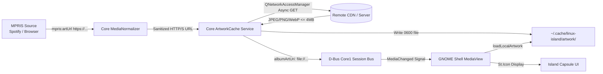

# Remote Album Artwork Implementation Plan

**Approved Goal:** Enable remote album artwork (e.g. Spotify, YouTube Music, Firefox/Chrome MPRIS streams) to display in Linux Island's media card and circular ambient thumbnail while keeping the GNOME Shell extension process completely offline, responsive, and secure.

---

## 1. Architecture & Design Principles

### Core-Managed Asynchronous Caching
* **GNOME Shell UI Stays Offline**: The GJS extension must never make direct outbound HTTP/HTTPS requests inside the Mutter/Shell process. Network stalls, DNS delays, or TLS handshakes must never block the compositor thread.
* **Core Daemon Fetches & Caches**: `linux-island-core` (Qt6 C++20 daemon) owns network transport via `QNetworkAccessManager`. It validates remote URLs, downloads artwork asynchronously in the background, enforces security constraints, and saves cached images to `~/.cache/linux-island/artwork/<sha256>.img`.
* **Zero D-Bus Contract Changes**: Core provides the cached local `file:///home/user/.cache/linux-island/artwork/<sha256>.img` path over D-Bus in `albumArtUri` on the existing `io.github.linuxisland.Core1` interface.
* **Extension Compatibility**: `extension/lib/localArtwork.js` receives a standard local `file:///` URI and applies its existing vetting: regular file, user-owned, size $\le 4\,\text{MB}$, valid pixbuf dimensions $\le 4096\times 4096\,\text{px}$.



---

## 2. Security, Privacy & Performance Constraints

1. **URL Sanitization**:
   - Allowed schemes: strictly `https://` (and `http://` for local loopback/intranet players).
   - Maximum URL length: 2048 characters.
   - Reject query strings containing user credentials or dangerous schemes (`file:`, `javascript:`, `data:`, `gresource:`).
2. **Resource Boundaries**:
   - Download timeout: 5.0 seconds maximum.
   - Maximum image size: 4 MB (aborts download if `Content-Length` or byte stream exceeds 4 MB).
   - Total disk cache limit: 50 MB with LRU eviction (pruning oldest cached files when cache exceeds 50 MB).
   - Rate limit: at most 1 active artwork download per player at any given time; cancelled immediately if track changes before completion.
3. **No Private Metadata Leakage**:
   - Never log image URLs, track titles, or artist names to `journalctl` or system logs.
   - File cache names are one-way SHA-256 hashes of the source URL.

---

## 3. Scope & File Touchpoints

### C++ Core (`linux-island-core`)
1. `core/media/media_normalizer.cpp`:
   - Update `sanitizeArtUrl()` to accept valid `https://` and `http://` schemes in addition to `file://` and `/`.
2. `core/media/artwork_cache.h` and `core/media/artwork_cache.cpp` (New Component):
   - Background worker with `QNetworkAccessManager`.
   - Methods: `fetchArtwork(const QUrl &url, CompletionCallback callback)`.
   - Eviction: periodic cleanup keeping cache $\le 50\,\text{MB}$.
3. `core/media/mpris_source.cpp` / `core/service/island_core.cpp`:
   - Route normalized remote `albumArtUri` through `ArtworkCache`.
   - On download completion, emit `MediaChanged` with the cached local file URI.
   - If offline or download fails, gracefully leave `albumArtUri` empty so UI displays symbolic fallback.

### Extension (`linux-island-extension`)
1. `extension/lib/localArtwork.js`:
   - Confirm `~/.cache/linux-island/artwork/` paths pass file ownership and size checks.
2. `extension/ui/mediaView.js`:
   - Artwork cancellation and update handling remains unchanged (already robust against async changes).

### Tests & Verification
1. `tests/unit/tst_media_normalizer.cpp`:
   - Unit tests verifying `sanitizeArtUrl` accepts valid HTTPS/HTTP URLs and rejects malicious schemes.
2. `tests/unit/tst_artwork_cache.cpp` (New Test Suite):
   - Tests covering URL hashing, size limits, timeout handling, file writing, and LRU pruning.
3. `tests/extension/local-artwork.gjs.js`:
   - Test verifying cached local files loaded from user cache directory.
4. `tests/integration/test_m0_scaffold.py`:
   - Regression verification of Core D-Bus contracts and schemas.

---

## 4. Implementation Steps (DAG)

- [ ] **Step 1: Core URL Normalizer Updates**
  - Allow `https://` and `http://` in `sanitizeArtUrl()`.
  - Add unit tests in `tests/unit/tst_media_normalizer.cpp`.
  - Run `ctest -R tst_media_normalizer` $\to$ GREEN.

- [ ] **Step 2: Core ArtworkCache Service**
  - Implement `ArtworkCache` class with `QNetworkAccessManager`.
  - Write `tests/unit/tst_artwork_cache.cpp` covering cache hit, download timeout, and size limits.
  - Run `ctest -R tst_artwork_cache` $\to$ GREEN.

- [ ] **Step 3: Core Media Pipeline Integration**
  - Wire `ArtworkCache` into `MprisSource` / `IslandCore`.
  - Emit D-Bus `MediaChanged` with cached `file://` URI once available.
  - Cancel in-flight download when track switches.

- [ ] **Step 4: Extension & Cache Permission Verification**
  - Verify `loadLocalArtwork` accepts `~/.cache/linux-island/artwork/` URIs.
  - Run `gjs -m tests/extension/local-artwork.gjs.js`.
  - Run `node tests/extension/capsule-rendering.test.js`.

- [ ] **Step 5: Full Suite Regression Gate**
  - Full CTest suite run (`ctest --output-on-failure`).
  - Core1 XML validation (`python3 scripts/dev/verify-kit.py`).
  - Build local binary and copy extension updates.

---

## 5. Verification Commands

```bash
# Core CTest suites
cmake -B build/dev -S . -DCMAKE_BUILD_TYPE=Debug
cmake --build build/dev
ctest --test-dir build/dev --output-on-failure

# Extension & Design QA
python3 scripts/dev/generate-island-css.py --check
python3 design-system/qa/verify_tokens.py
node tests/extension/capsule-rendering.test.js
node tests/extension/feature-carousel.test.js
node tests/extension/state-machine.test.js

# Static & Contract Check
python3 scripts/dev/verify-kit.py
python3 tests/integration/test_m0_scaffold.py
```
