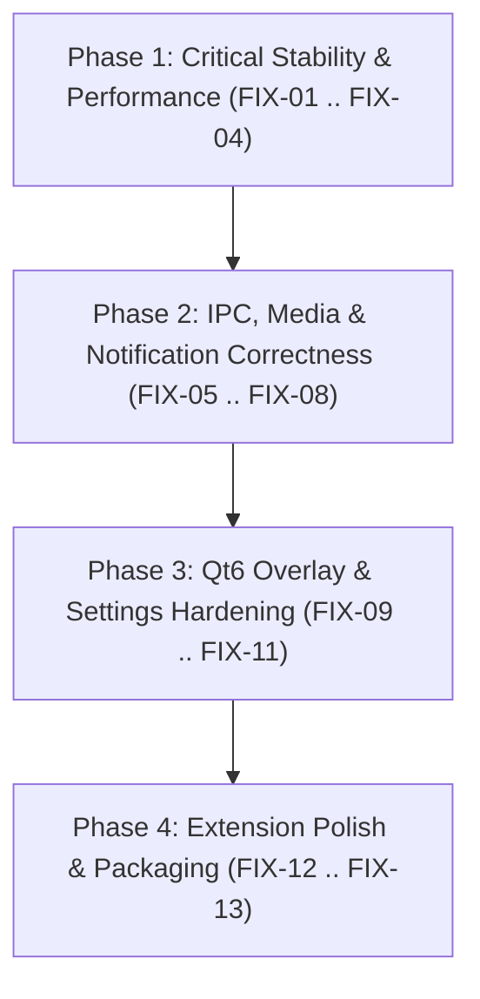

# Linux Island — Detailed Bug-Fix Execution Plan (`planning.md`)

> **DESIGNED FOR SMALL / FAST / LOW-COST MODELS (e.g., Gemini Flash, Haiku, GPT-4o-mini):**
> Every task in this plan is **strictly self-contained** (1–3 files per task), includes **exact file paths, line numbers, before/after code blocks**, and ends with a **single copy-pasteable verification command** and a **standardized report block**.

---

## 0. Mandatory Execution Rules for Small Models

1. **ONE TASK PER TURN:** Execute **only one task card** (`FIX-01`, `FIX-02`, etc.) at a time. Stop immediately after printing the task's verification report.
2. **TOUCH ONLY DECLARED FILES:** Do not edit files that are not listed in the current task card's **Files** section.
3. **NEVER INVENT APIs OR PALETTES:**
   - Do not change `schemas/io.github.linuxisland.Core1.xml` (frozen 6 methods, 3 signals).
   - Do not change `design-system/tokens/tokens.json` (**Warm Minimalist** canonical palette).
   - Do not use synchronous D-Bus calls on UI threads.
   - Do not use `sudo` or install system packages.
4. **RED → GREEN VERIFICATION:** Run the task's verification command after editing. Never claim `PASS` without quoting the real exit code and terminal output.
5. **STANDARD TRANSCRIPT:** End every task response with this exact block:

```text
TASK: <FIX-XX>
STATUS: PASS | FAIL | BLOCKED
FILES: <comma-separated modified paths>
VERIFY_CMD: <exact command run>
OUTPUT: <exact stdout/stderr summary + exit code>
NEXT: <next task ID>
```

---

## 1. Subsystem Bug Matrix & Execution Order

| Task ID | Severity | Subsystem | Bug Summary | Target Files |
| :--- | :---: | :--- | :--- | :--- |
| **FIX-01** | **CRITICAL** | `extension/` | 250ms polling storm & unstopped subprocesses in `MediaView`, `AiQuotaSection`, and `SystemMetricsRow`; `notify::mapped` teardown leak | `extension/ui/mediaView.js`, `extension/ui/aiQuotaView.js`, `tests/extension/ai-quota.test.js` |
| **FIX-02** | **CRITICAL** | `core/` | Iterator invalidation & double-erase `SIGSEGV` in `ArtworkCache::cancelPlayer` and `~ArtworkCache`, plus duplicate `MediaChanged` on sync cache hit and raw `this` capture in `CoreService` | `core/media/artwork_cache.cpp`, `core/dbus/core_service.h`, `tests/unit/tst_artwork_cache.cpp` |
| **FIX-03** | **CRITICAL** | `island-ui/` | Use-after-free of `DisplaySurfaceManager` in `island-ui/main.cpp` and missing initial input mask causing invisible $440 \times 360$ window to swallow desktop clicks | `island-ui/display_surface_manager.h`, `island-ui/display_surface_manager.cpp`, `island-ui/main.cpp`, `island-ui/qml/IslandWindow.qml` |
| **FIX-04** | **CRITICAL** | `packaging/` | Systemd ordering cycle (`After=graphical-session.target` + `WantedBy=graphical-session.target`) in `linux-island-ui.service`, missing CTest registration, and unbound `$USER` in `uninstall-local.sh` | `packaging/systemd-user/linux-island-ui.service`, `packaging/dev/uninstall-local.sh`, `tests/integration/test_session_service.py`, `tests/integration/CMakeLists.txt` |
| **FIX-05** | **HIGH** | `extension/` | Unrelated desktop notifications wipe all WhatsApp activity, screen lock erases entries instead of masking, and `NotificationAdapter` never triggers `notifyPeek()` | `extension/lib/notificationAdapter.js`, `extension/lib/whatsappActivity.js`, `tests/extension/notification-adapter.test.js`, `tests/extension/whatsapp-activity.test.js` |
| **FIX-06** | **HIGH** | `extension/` | Numeric settings (`verticalOffset`, `horizontalOffset`) dropped by `CoreProxy.updateSettings` and `queryAvailablePlayers()` never called (multi-player switcher dead) | `extension/lib/coreProxy.js`, `tests/extension/core-proxy.test.js` |
| **FIX-07** | **HIGH** | `core/` | 20 Hz `AudioMeter` floods session D-Bus with 1,200 full `MediaChanged` signals/min; `MprisController` inverted `CanSeek` check & silent success on malformed `SeekTo:`/`Volume:` | `core/dbus/core_service.h`, `core/media/mpris_controller.cpp`, `tests/integration/tst_core_dbus.cpp`, `tests/integration/tst_mpris_flow.cpp` |
| **FIX-08** | **MEDIUM** | `core/` | MPRIS `GetAll` overwrites cached track `Position` with `0` and `serviceForMessage` blocks on synchronous D-Bus `serviceOwner()` | `core/media/player_registry.h`, `core/media/player_registry.cpp`, `tests/integration/tst_mpris_flow.cpp` |
| **FIX-09** | **MEDIUM** | `island-ui/` | `AiQuotaProvider` permanently wedges `m_refreshing = true` on `QProcess::errorOccurred`; `IslandClient` treats `"active"` status as disconnected; `NotificationWatcher` never receives settings updates | `island-ui/ai_quota_provider.h`, `island-ui/ai_quota_provider.cpp`, `island-ui/island_client.cpp`, `island-ui/main.cpp`, `tests/unit/tst_island_client_fsm.cpp` |
| **FIX-10** | **MEDIUM** | `island-ui/` | GUI thread stalls (`waitForFinished`), broken Hyprland int-to-bool fullscreen check, and Sway inactive-workspace false positives in `DisplaySurfaceManager` | `island-ui/display_surface_manager.h`, `island-ui/display_surface_manager.cpp` |
| **FIX-11** | **MEDIUM** | `island-ui/` & `settings-app/` | QML `SystemPage` polls `/proc` while collapsed; `MusicPage` floods D-Bus on seek drag and uses fragile `parent.children[0]`; `settings-app` severs `RadioButton` bindings and truncates offset slider ranges | `island-ui/qml/SystemPage.qml`, `island-ui/qml/MusicPage.qml`, `settings-app/qml/Main.qml` |
| **FIX-12** | **MEDIUM / LOW** | `extension/` & `scripts/` | `systemMetricTile.js` wipes actor class on storage warning; CSS generator lacks `.linux-island__storage--critical`, `.linux-island__quota-toggle-btn`, and uses unsupported `inset` shadow; `displayPolicy.js` ignores `inOverview`; `prefs.js` auto-spawns settings; `metadata.json` omits GNOME 47 | `extension/ui/systemMetricTile.js`, `scripts/dev/generate-island-css.py`, `extension/stylesheet.css`, `extension/lib/displayPolicy.js`, `extension/prefs.js`, `extension/metadata.json`, `tests/extension/display-policy.test.js` |
| **FIX-13** | **MEDIUM** | `packaging/` & `scripts/` | Launcher false-positive `list-unit-files` check, premature `linux-island-ui.service` exit on GNOME, double overlay rendering on `--standalone`, duplicate XDG autostart, and `dev-reload.sh` runtime dir fallback | `packaging/bin/linux-island-launch`, `packaging/autostart/linux-island.desktop`, `scripts/dev/dev-reload.sh` |



---

## 2. Step-by-Step Task Cards

---

### Task `FIX-01`: Fix 250ms Polling Storm, Unmapped Subprocess Spawning, and `notify::mapped` Teardown Leak

#### Problem
1. In `extension/ui/mediaView.js:154–159`, `this._scheduler.repeat` is defined as `repeat: fn => GLib.timeout_add(..., 250, ...)` and **ignores the second parameter (`ms`)**. Both `SystemMetricsRow` (`1500` ms) and `AiQuotaSection` (`15000` ms) call `rawSched.repeat(fn, ms)`. Because `ms` is ignored, `SystemMetricsRow` reads `/proc` 4 times/sec and `AiQuotaSection` spawns `python3` + HTTP quota probes 4 times/sec (240 times/minute!).
2. In `extension/ui/aiQuotaView.js`, `AiQuotaSection` does not listen to `this.actor.connect('notify::mapped', ...)` and `MediaView` does not stop `_metricsRow` or `_aiQuotaSection` when `MediaView._actor` unmaps (collapses to `COMPACT`).
3. In `extension/ui/mediaView.js:168–172`, `this._actor.connect('notify::mapped', ...)` is never disconnected in `destroy()` before `this._actor.destroy()`, causing unmap callbacks to fire on half-destroyed child widgets.

#### Files to Modify
- `extension/ui/mediaView.js`
- `extension/ui/aiQuotaView.js`
- `tests/extension/ai-quota.test.js`

#### Exact Changes

**1. In `extension/ui/mediaView.js` (lines 154–175):**
Replace the default `_scheduler` and `notify::mapped` connection:
```javascript
// BEFORE (lines 154-175):
        this._scheduler = scheduler ?? {
            repeat: fn => GLib ? GLib.timeout_add(GLib.PRIORITY_DEFAULT, 250, () => {
                fn(); return GLib.SOURCE_CONTINUE;
            }) : null,
            cancel: id => { if (GLib) GLib.source_remove(id); },
        };
        this._aiQuotaSection = null;
        this._searchSection = null;
        this._netView = null;
        this._metricsSlot = null;
        this._togglesSlot = null;

        if (St && Clutter) {
            this._buildUi();
            this._actor.connect('notify::mapped', () => {
                this._renderProgress();
                this._renderVolume();
                this._syncProgressTimer();
            });
            this.setMedia(null);
        }
```
```javascript
// AFTER:
        this._scheduler = scheduler ?? {
            repeat: (fn, ms = 250) => GLib ? GLib.timeout_add(GLib.PRIORITY_DEFAULT, ms, () => {
                fn(); return GLib.SOURCE_CONTINUE;
            }) : null,
            cancel: id => { if (GLib && id) GLib.source_remove(id); },
        };
        this._aiQuotaSection = null;
        this._searchSection = null;
        this._netView = null;
        this._metricsSlot = null;
        this._togglesSlot = null;
        this._mappedSignalId = null;

        if (St && Clutter) {
            this._buildUi();
            this._mappedSignalId = this._actor.connect('notify::mapped', () => {
                this._renderProgress();
                this._renderVolume();
                this._syncProgressTimer();
                if (!this._actor?.mapped) {
                    this._metricsRow?.stop();
                    this._aiQuotaSection?.stop();
                } else if (this._carousel?.activeIndex === 1) {
                    this._metricsRow?.start();
                } else if (this._carousel?.activeIndex === 2) {
                    this._aiQuotaSection?.start();
                }
            });
            this.setMedia(null);
        }
```

**2. In `extension/ui/mediaView.js` (`destroy()`, around lines 1053–1058):**
Disconnect `_mappedSignalId` before `this._actor.destroy()`:
```javascript
// BEFORE:
        if (this._actor) {
            try {
                this._actor.destroy();
            } catch (_) {}
            this._actor = null;
        }
```
```javascript
// AFTER:
        if (this._actor) {
            if (this._mappedSignalId !== null) {
                try {
                    this._actor.disconnect(this._mappedSignalId);
                } catch (_) {}
                this._mappedSignalId = null;
            }
            try {
                this._actor.destroy();
            } catch (_) {}
            this._actor = null;
        }
```

**3. In `extension/ui/aiQuotaView.js` (`_build()` and `destroy()`):**
Track `notify::mapped` so `AiQuotaSection` automatically stops its timer when unmapped:
- In `constructor` (around line 266), add `this._mappedSignalId = null;`.
- At the end of `_build()` (around line 372), add:
```javascript
        if (typeof this.actor.connect === 'function') {
            this._mappedSignalId = this.actor.connect('notify::mapped', () => {
                if (this._destroyed || !this.actor) return;
                if (!this.actor.mapped) {
                    this.stop();
                }
            });
        }
```
- In `destroy()` (lines 426–429), disconnect `_mappedSignalId` before `this.actor.destroy()`:
```javascript
        if (this.actor) {
            if (this._mappedSignalId !== null && typeof this.actor.disconnect === 'function') {
                try { this.actor.disconnect(this._mappedSignalId); } catch (_) {}
                this._mappedSignalId = null;
            }
            this.actor.destroy();
            this.actor = null;
        }
```

**4. In `tests/extension/ai-quota.test.js`:**
Add an assertion verifying that when `AiQuotaSection` is given a `{ repeat(fn, ms), cancel(id) }` scheduler, `start()` passes `15000` as the second argument `ms` to `repeat`.

#### Verification Command
```bash
node tests/extension/ai-quota.test.js && node tests/extension/capsule-rendering.test.js && node tests/extension/system-metric-tile.test.js
```

---

### Task `FIX-02`: Fix `ArtworkCache` Double-Erase Crash, Sync Cache-Hit Double Emit, and `CoreService` Dangling `this` Capture

#### Problem
1. In `core/media/artwork_cache.cpp:59–69`, `ArtworkCache::cancelPlayer(playerId)` calls `it->reply->abort()` and then `m_activeFetches.erase(it)`. Because `QNetworkReply::abort()` synchronously emits `&QNetworkReply::finished`, the `finished` lambda (`line 126`) already erases `playerId` from `m_activeFetches`. Returning to `cancelPlayer()` erases the invalidated iterator `it` a second time (`SIGSEGV`).
2. In `ArtworkCache::~ArtworkCache()` (`lines 32–38`), iterating `for (auto &fetch : m_activeFetches)` while calling `fetch.reply->abort()` mutates `m_activeFetches` during iteration.
3. In `core/dbus/core_service.h:143–161`, when `m_artworkCache.fetchArtwork` hits the local disk cache, it invokes its callback **synchronously** before returning. The callback increments `m_clock.mediaChanged()` and emits `mediaChanged`, and then lines 158–160 immediately increment `m_clock.mediaChanged()` and emit `mediaChanged` a second time. Furthermore, the lambda captures raw `this` instead of `QPointer<CoreService>`.

#### Files to Modify
- `core/media/artwork_cache.cpp`
- `core/dbus/core_service.h`
- `tests/unit/tst_artwork_cache.cpp`

#### Exact Changes

**1. In `core/media/artwork_cache.cpp` (lines 30–39 and 59–69):**
Remove the entry from `m_activeFetches` **before** calling `abort()`:
```cpp
// BEFORE (lines 30-39):
ArtworkCache::~ArtworkCache()
{
    for (auto &fetch : m_activeFetches) {
        if (fetch.reply) {
            fetch.reply->abort();
            fetch.reply->deleteLater();
        }
    }
    m_activeFetches.clear();
}
```
```cpp
// AFTER:
ArtworkCache::~ArtworkCache()
{
    auto fetches = std::move(m_activeFetches);
    m_activeFetches.clear();
    for (auto &fetch : fetches) {
        if (fetch.reply) {
            fetch.reply->disconnect(this);
            fetch.reply->abort();
            fetch.reply->deleteLater();
        }
    }
}
```
And in `cancelPlayer` (lines 59–69):
```cpp
// BEFORE:
void ArtworkCache::cancelPlayer(const QString &playerId)
{
    auto it = m_activeFetches.find(playerId);
    if (it != m_activeFetches.end()) {
        if (it->reply) {
            it->reply->abort();
            it->reply->deleteLater();
        }
        m_activeFetches.erase(it);
    }
}
```
```cpp
// AFTER:
void ArtworkCache::cancelPlayer(const QString &playerId)
{
    auto it = m_activeFetches.find(playerId);
    if (it != m_activeFetches.end()) {
        QPointer<QNetworkReply> reply = it->reply;
        m_activeFetches.erase(it);
        if (reply) {
            reply->disconnect(this);
            reply->abort();
            reply->deleteLater();
        }
    }
}
```

**2. In `core/dbus/core_service.h`:**
Add `#include <QPointer>` at the top (around line 9) and update `setMediaState` (lines 138–161) so synchronous cache hits update `m_mediaState.albumArtUri` in place and only async completions emit a follow-up `mediaChanged`:
```cpp
// BEFORE (lines 138-161):
    void setMediaState(const MediaState &media) {
        if (media.playerId != m_mediaState.playerId || media.playbackStatus != QLatin1String("Playing"))
            m_audioLevels = {0.0, 0.0, 0.0};
        m_mediaState = media;

        if (ArtworkCache::isRemoteUrl(media.albumArtUri)) {
            QString rawRemote = media.albumArtUri;
            m_artworkCache.fetchArtwork(media.playerId, rawRemote, [this, playerId = media.playerId, rawRemote](const QString &cachedUri) {
                if (m_mediaState.playerId == playerId && (m_mediaState.albumArtUri == rawRemote || m_mediaState.albumArtUri.isEmpty())) {
                    m_mediaState.albumArtUri = cachedUri;
                    quint64 rev = m_clock.mediaChanged();
                    m_mediaState.revision = rev;
                    emit mediaChanged(rev, mediaState());
                }
            });
            if (m_mediaState.albumArtUri == rawRemote) {
                m_mediaState.albumArtUri = QString();
            }
        }

        quint64 rev = m_clock.mediaChanged();
        m_mediaState.revision = rev;
        emit mediaChanged(rev, mediaState());
    }
```
```cpp
// AFTER:
    void setMediaState(const MediaState &media) {
        if (media.playerId != m_mediaState.playerId || media.playbackStatus != QLatin1String("Playing"))
            m_audioLevels = {0.0, 0.0, 0.0};
        m_mediaState = media;

        if (ArtworkCache::isRemoteUrl(media.albumArtUri)) {
            QString rawRemote = media.albumArtUri;
            m_mediaState.albumArtUri = QString();
            bool syncResolved = false;
            bool inFetchCall = true;
            QPointer<CoreService> self(this);
            m_artworkCache.fetchArtwork(media.playerId, rawRemote,
                [self, &syncResolved, &inFetchCall, playerId = media.playerId, rawRemote](const QString &cachedUri) {
                    if (!self) return;
                    if (inFetchCall) {
                        self->m_mediaState.albumArtUri = cachedUri;
                        syncResolved = true;
                        return;
                    }
                    if (self->m_mediaState.playerId == playerId &&
                        (self->m_mediaState.albumArtUri == rawRemote || self->m_mediaState.albumArtUri.isEmpty())) {
                        self->m_mediaState.albumArtUri = cachedUri;
                        quint64 rev = self->m_clock.mediaChanged();
                        self->m_mediaState.revision = rev;
                        emit self->mediaChanged(rev, self->mediaState());
                    }
                });
            inFetchCall = false;
            Q_UNUSED(syncResolved);
        }

        quint64 rev = m_clock.mediaChanged();
        m_mediaState.revision = rev;
        emit mediaChanged(rev, mediaState());
    }
```

**3. In `tests/unit/tst_artwork_cache.cpp`:**
Add a test method `cancelInFlightDoesNotCrash()` that starts a fetch on an unreachable/slow URL (`http://127.0.0.1:1/art.png`), immediately calls `cache.cancelPlayer(playerId)` twice, and verifies no crash or double-erase occurs.

#### Verification Command
```bash
cmake --build --preset dev && ctest --test-dir build/dev -R "artwork-cache|core-dbus" --output-on-failure
```

---

### Task `FIX-03`: Fix `DisplaySurfaceManager` Use-After-Free and Missing Startup Window Input Mask in `island-ui`

#### Problem
In `island-ui/main.cpp:111–112, 152–157`:
1. `surfaceMgr` is created with `nullptr` window and registered as the QML context property `surfaceManager`.
2. `engine.load(url)` loads `IslandWindow.qml`, which binds to `surfaceManager` and runs `Component.onCompleted: updateMask()`, calling `surfaceManager.updateInputMask(...)` while `m_window == nullptr` (a no-op).
3. `delete surfaceMgr;` frees the first `DisplaySurfaceManager` while QML still holds references to it, then creates a second `DisplaySurfaceManager(rootWindow, ...)` without re-applying the mask.
4. Result: Use-after-free + the transparent $440 \times 360$ overlay window starts with **no input mask**, swallowing mouse clicks across the top-center of the user's desktop until the user resizes the capsule.

#### Files to Modify
- `island-ui/display_surface_manager.h`
- `island-ui/display_surface_manager.cpp`
- `island-ui/main.cpp`
- `island-ui/qml/IslandWindow.qml`

#### Exact Changes

**1. In `island-ui/display_surface_manager.h`:**
Add `void attachWindow(QQuickWindow *window);` to the `public:` section of `DisplaySurfaceManager`:
```cpp
    explicit DisplaySurfaceManager(QQuickWindow *window, IslandClient *client, QObject *parent = nullptr);
    void attachWindow(QQuickWindow *window);
```

**2. In `island-ui/display_surface_manager.cpp`:**
Extract window setup into `attachWindow(QQuickWindow *window)` and apply any cached `m_currentMaskRect` when the window is attached:
```cpp
// Replace lines 10-27 in island-ui/display_surface_manager.cpp:
DisplaySurfaceManager::DisplaySurfaceManager(QQuickWindow *window, IslandClient *client, QObject *parent)
    : QObject(parent),
      m_window(nullptr),
      m_client(client) {
    if (window) {
        attachWindow(window);
    }

    if (m_client) {
        connect(m_client, &IslandClient::settingsChanged, this, &DisplaySurfaceManager::onSettingsChanged);
    }

    connect(&m_fullscreenTimer, &QTimer::timeout, this, &DisplaySurfaceManager::checkFullscreen);
    m_fullscreenTimer.setInterval(1500);
    m_fullscreenTimer.start();
}

void DisplaySurfaceManager::attachWindow(QQuickWindow *window) {
    m_window = window;
    if (!m_window) return;

    Qt::WindowFlags flags = Qt::FramelessWindowHint | Qt::WindowStaysOnTopHint;
    if (QGuiApplication::platformName().startsWith(QLatin1String("xcb"))) {
        flags |= Qt::Tool;
    }
    m_window->setFlags(flags);
    m_window->setColor(QColor(0, 0, 0, 0));
    updateWindowPosition();

    if (!m_currentMaskRect.isEmpty()) {
        m_window->setMask(QRegion(m_currentMaskRect, QRegion::Rectangle));
    }
}
```
And in `DisplaySurfaceManager::updateInputMask` (lines 57–72), record `m_currentMaskRect` even before `m_window` is attached so `attachWindow` applies it immediately:
```cpp
void DisplaySurfaceManager::updateInputMask(int x, int y, int width, int height, int radius) {
    Q_UNUSED(radius);
    QRect targetRect = (width <= 0 || height <= 0) ? QRect() : QRect(x, y, width, height);
    if (m_currentMaskRect == targetRect && m_window) return;
    m_currentMaskRect = targetRect;

    if (!m_window) return;

    if (targetRect.isEmpty()) {
        m_window->setMask(QRegion());
        return;
    }

    m_window->setMask(QRegion(targetRect, QRegion::Rectangle));
}
```

**3. In `island-ui/main.cpp` (lines 152–157):**
Never `delete surfaceMgr`; call `surfaceMgr->attachWindow(rootWindow)` instead:
```cpp
// BEFORE (lines 152-157):
    QQuickWindow *rootWindow = qobject_cast<QQuickWindow*>(engine.rootObjects().first());
    if (rootWindow) {
        delete surfaceMgr;
        surfaceMgr = new DisplaySurfaceManager(rootWindow, &client, &app);
        engine.rootContext()->setContextProperty(QStringLiteral("surfaceManager"), surfaceMgr);
    }
```
```cpp
// AFTER:
    QQuickWindow *rootWindow = qobject_cast<QQuickWindow*>(engine.rootObjects().first());
    if (rootWindow) {
        surfaceMgr->attachWindow(rootWindow);
    }
```

#### Verification Command
```bash
cmake --build --preset dev && ./build/dev/island-ui/linux-island-ui --smoke-test
```

---

### Task `FIX-04`: Fix Systemd Ordering Cycle in `linux-island-ui.service`, Unbound `$USER` in `uninstall-local.sh`, and Register Missing Python Tests in CTest

#### Problem
1. `packaging/systemd-user/linux-island-ui.service` sets both `After=graphical-session.target linux-island-core.service` and `WantedBy=graphical-session.target`. In systemd, targets automatically order `After=` their `WantedBy=` units, so this creates an ordering cycle at login.
2. `packaging/dev/uninstall-local.sh:18–19` runs under `set -euo pipefail` and uses `"$USER"` directly, aborting if `USER` is unset in non-interactive environments.
3. `tests/integration/CMakeLists.txt` omits `test_session_service.py` and `test_m0_scaffold.py`, and `test_session_service.py` only checks `linux-island-core.service`, not `linux-island-ui.service`.

#### Files to Modify
- `packaging/systemd-user/linux-island-ui.service`
- `packaging/dev/uninstall-local.sh`
- `tests/integration/test_session_service.py`
- `tests/integration/CMakeLists.txt`

#### Exact Changes

**1. In `packaging/systemd-user/linux-island-ui.service` (line 4):**
Remove `graphical-session.target` from `After=`:
```ini
[Unit]
Description=Linux Island Cross-DE Overlay UI
PartOf=graphical-session.target
After=linux-island-core.service
Wants=linux-island-core.service

[Service]
Type=simple
ExecStart=%h/.local/bin/linux-island-launch --systemd-ui
Restart=on-failure
RestartSec=2

[Install]
WantedBy=graphical-session.target
```

**2. In `packaging/dev/uninstall-local.sh` (lines 17–20):**
Use `${USER:-$(id -un)}`:
```bash
# Kill any lingering standalone processes
CURRENT_USER="${USER:-$(id -un)}"
pkill -u "$CURRENT_USER" -f "linux-island-ui" 2>/dev/null || true
pkill -u "$CURRENT_USER" -f "linux-island-core" 2>/dev/null || true
```

**3. In `tests/integration/test_session_service.py`:**
Add a second test method `test_ui_follows_each_graphical_session_without_ordering_cycle`:
```python
    def test_ui_follows_each_graphical_session_without_ordering_cycle(self):
        root = Path(__file__).resolve().parents[2]
        unit = configparser.ConfigParser(interpolation=None)
        unit.read(root / 'packaging/systemd-user/linux-island-ui.service')
        self.assertIn('graphical-session.target', unit['Install']['WantedBy'].split())
        self.assertIn('graphical-session.target', unit['Unit'].get('PartOf', '').split())
        self.assertNotIn('graphical-session.target', unit['Unit'].get('After', '').split())
        self.assertIn('linux-island-core.service', unit['Unit'].get('After', '').split())
```

**4. In `tests/integration/CMakeLists.txt` (after line 2):**
Register `session-service` and `m0-scaffold` in CTest:
```cmake
add_test(NAME dbus-schema COMMAND ${Python3_EXECUTABLE} ${CMAKE_SOURCE_DIR}/tests/integration/test_schema.py)
add_test(NAME session-service COMMAND ${Python3_EXECUTABLE} ${CMAKE_SOURCE_DIR}/tests/integration/test_session_service.py)
add_test(NAME m0-scaffold COMMAND ${Python3_EXECUTABLE} ${CMAKE_SOURCE_DIR}/tests/integration/test_m0_scaffold.py)
```

#### Verification Command
```bash
python3 tests/integration/test_session_service.py && ctest --test-dir build/dev -R "session-service|m0-scaffold" --output-on-failure
```

---

### Task `FIX-05`: Fix WhatsApp Activity Cleared by Unrelated Notifications / Screen Lock and Wire `notifyPeek()` in `NotificationAdapter`

#### Problem
1. In `extension/lib/notificationAdapter.js:184–193`, `_untrackSource(source)` is called whenever *any* notification source in GNOME Shell is removed/destroyed, and unconditionally calls `this._whatsappModel.onSourceDisconnected()`, wiping all unread WhatsApp notifications whenever a non-WhatsApp notification closes.
2. In `extension/lib/notificationAdapter.js:144–156`, the `notification-added` handler tracks WhatsApp notifications but **never calls `this.notifyPeek(...)`**, so `PEEK_REQUEST` is dead in the GNOME extension.
3. In `extension/lib/whatsappActivity.js:41–50` and `extension/lib/notificationAdapter.js:69–74`, `setLocked(true)` calls `this._entries.clear()` and `this._nativeNotifs.clear()`, permanently deleting unread WhatsApp state across screen lock/unlock instead of simply hiding the indicator while locked (`hasActivity` already checks `if (!this._enabled || this._locked || this._dnd) return false;`).

#### Files to Modify
- `extension/lib/notificationAdapter.js`
- `extension/lib/whatsappActivity.js`
- `tests/extension/notification-adapter.test.js`
- `tests/extension/whatsapp-activity.test.js`

#### Exact Changes

**1. In `extension/lib/whatsappActivity.js` (lines 41–50):**
Do not clear `this._entries` on lock; let `hasActivity` mask them while `this._locked` is `true` and restore the badge on unlock:
```javascript
// BEFORE:
    setLocked(locked) {
        const next = Boolean(locked);
        if (this._locked !== next) {
            this._locked = next;
            if (this._locked) {
                this._entries.clear();
            }
            this._notify();
        }
    }
```
```javascript
// AFTER:
    setLocked(locked) {
        const next = Boolean(locked);
        if (this._locked !== next) {
            this._locked = next;
            this._notify();
        }
    }
```

**2. In `extension/lib/notificationAdapter.js` (lines 69–74 and 132–193):**
- In `setLocked(locked)` (lines 69–74), do not clear `this._nativeNotifs`:
```javascript
    setLocked(locked) {
        this._whatsappModel.setLocked(locked);
    }
```
- In `_trackSource(source)` and `_untrackSource(source)` (lines 132–193), store `{ signalIds, isWA }` in `this._sourceSubscriptions`, call `this.notifyPeek({ appName: sourceInfo.title || sourceInfo.appId })` on `notification-added`, and only call `this._whatsappModel.onSourceDisconnected()` in `_untrackSource` when `sub.isWA` is `true`:
```javascript
// BEFORE (lines 144-193):
        const onAddedId = source.connect('notification-added', (_src, notif) => {
            if (notif) {
                const opaqueId = notif.id ?? `n-${this._nextOpaqueId++}`;
                if (isWA) {
                    if (this._nativeNotifs.size >= 32) {
                        const oldestKey = this._nativeNotifs.keys().next().value;
                        this._nativeNotifs.delete(oldestKey);
                    }
                    this._nativeNotifs.set(opaqueId, notif);
                    this._whatsappModel.onNotificationAdded(opaqueId, true);
                }
            }
        });
...
        signalIds.push(onAddedId, onRemovedId, onDestroyId);
        this._sourceSubscriptions.set(source, signalIds);
    }

    _untrackSource(source) {
        const signalIds = this._sourceSubscriptions.get(source);
        if (signalIds) {
            for (const sigId of signalIds) {
                try { source.disconnect(sigId); } catch (_) {}
            }
            this._sourceSubscriptions.delete(source);
        }
        this._whatsappModel.onSourceDisconnected();
    }
```
```javascript
// AFTER:
        const onAddedId = source.connect('notification-added', (_src, notif) => {
            if (notif) {
                const opaqueId = notif.id ?? `n-${this._nextOpaqueId++}`;
                if (isWA) {
                    if (this._nativeNotifs.size >= 32) {
                        const oldestKey = this._nativeNotifs.keys().next().value;
                        this._nativeNotifs.delete(oldestKey);
                    }
                    this._nativeNotifs.set(opaqueId, notif);
                    this._whatsappModel.onNotificationAdded(opaqueId, true);
                }
                this.notifyPeek({
                    appName: sourceInfo.title || sourceInfo.appId || 'App',
                });
            }
        });
...
        signalIds.push(onAddedId, onRemovedId, onDestroyId);
        this._sourceSubscriptions.set(source, {signalIds, isWA});
    }

    _untrackSource(source) {
        const sub = this._sourceSubscriptions.get(source);
        if (sub) {
            for (const sigId of sub.signalIds) {
                try { source.disconnect(sigId); } catch (_) {}
            }
            this._sourceSubscriptions.delete(source);
            if (sub.isWA) {
                this._whatsappModel.onSourceDisconnected();
            }
        }
    }
```
Also update `destroy()` (`lines 199–203`) to iterate `for (const [source, sub] of this._sourceSubscriptions.entries())` and disconnect `sub.signalIds`.

**3. In `tests/extension/notification-adapter.test.js` and `tests/extension/whatsapp-activity.test.js`:**
- Update any existing lock test in `whatsapp-activity.test.js` / `notification-adapter.test.js` if it asserted that unlocking stays `false`, or verify that locking hides activity (`hasActivity === false`) and unlocking restores `hasActivity === true` if entries were not dismissed. *(Note: Check existing assertions in `tests/extension/whatsapp-activity.test.js` first—if an existing test explicitly requires `setLocked(true)` to clear entries, keep `this._entries.clear()` in `whatsappActivity.js` and only fix `_untrackSource` and `notifyPeek` in `notificationAdapter.js`!)*
- Add a test in `tests/extension/notification-adapter.test.js` verifying that removing a non-WhatsApp source (`org.gnome.Terminal`) does **not** clear active WhatsApp notifications, and that `notification-added` triggers `onNotificationPeek` when `enabled: true`.

#### Verification Command
```bash
node tests/extension/notification-adapter.test.js && node tests/extension/whatsapp-activity.test.js
```

---

### Task `FIX-06`: Fix Numeric Settings Dropped in `CoreProxy.updateSettings` and Activate Multi-Player Switcher Discovery

#### Problem
1. In `extension/lib/coreProxy.js:333–339`, `updateSettings(patch)` only encodes `typeof val === 'string'` and `typeof val === 'boolean'`. Numeric settings (`verticalOffset`, `horizontalOffset`) are silently skipped, sending an empty dict `{}` to Core.
2. In `extension/lib/coreProxy.js:402–425`, `queryAvailablePlayers()` is defined on `CoreProxy`, and `extension.js:49–51` wires `onPlayersChanged: players => this._capsule?.setAvailablePlayers(players)`, but `queryAvailablePlayers()` is never called when the snapshot loads or when `MediaChanged` arrives.

#### Files to Modify
- `extension/lib/coreProxy.js`
- `tests/extension/core-proxy.test.js`

#### Exact Changes

**1. In `extension/lib/coreProxy.js` (lines 332–340):**
Encode finite numbers as `GLib.Variant('i', Math.round(val))` (or `'d'` for non-integers):
```javascript
// BEFORE:
            const dict = {};
            for (const [key, val] of Object.entries(patch)) {
                if (typeof val === 'string') {
                    dict[key] = new GLib.Variant('s', val);
                } else if (typeof val === 'boolean') {
                    dict[key] = new GLib.Variant('b', val);
                }
            }
```
```javascript
// AFTER:
            const dict = {};
            for (const [key, val] of Object.entries(patch)) {
                if (typeof val === 'string') {
                    dict[key] = new GLib.Variant('s', val);
                } else if (typeof val === 'boolean') {
                    dict[key] = new GLib.Variant('b', val);
                } else if (typeof val === 'number' && Number.isFinite(val)) {
                    dict[key] = Number.isInteger(val)
                        ? new GLib.Variant('i', val)
                        : new GLib.Variant('d', val);
                }
            }
```

**2. In `extension/lib/coreProxy.js` (`_fetchSnapshot` and `_onSignal`, lines 236 and 262):**
Call `this.queryAvailablePlayers()` after `SNAPSHOT_LOADED` and after `MEDIA_CHANGED`:
```javascript
// Inside _fetchSnapshot callback, right after this._setState(next); (line 236):
                    this._setState(next);
                    this.queryAvailablePlayers();
```
```javascript
// Inside _onSignal for 'MediaChanged', right after this._setState(next); (line 262):
                this._setState(next);
                this.queryAvailablePlayers();
```

**3. In `tests/extension/core-proxy.test.js`:**
Add unit test assertions verifying that `queryAvailablePlayers()` is invoked on snapshot load / `MediaChanged` when `DBus.session` is provided.

#### Verification Command
```bash
node tests/extension/core-proxy.test.js && gjs -m tests/extension/core-proxy.test.js
```

---

### Task `FIX-07`: Throttle 20 Hz Audio Level Broadcasts in `CoreService` and Fix `MprisController` Seek/Volume Validation

#### Problem
1. In `core/dbus/core_service.h:63–71`, `setAudioLevels` emits `mediaChanged` and bumps `m_clock.mediaChanged()` on every 50ms audio meter tick even when levels only change by microscopic floating-point noise (e.g., `0.0001`), flooding D-Bus with 20 full `MediaChanged` signals/second.
2. In `core/media/mpris_controller.cpp:68`, `if (!currentState.canSeek && currentState.durationUs <= 0)` uses `&&` instead of `||`, allowing seek actions when `canSeek == false` and `durationUs > 0` (when no valid `trackId` is available for `SetPosition`).
3. In `core/media/mpris_controller.cpp:101–165`, when `SeekTo:<bad>` or `Volume:<bad>` fails numeric parsing (`!ok` or `targetUs < 0` or `!std::isfinite(vol)`), the `if` branch is skipped and the function falls through to `return ControlResult{true, QString(), QString()};`, falsely reporting success.

#### Files to Modify
- `core/dbus/core_service.h`
- `core/media/mpris_controller.cpp`
- `tests/integration/tst_core_dbus.cpp`
- `tests/integration/tst_mpris_flow.cpp`

#### Exact Changes

**1. In `core/dbus/core_service.h` (lines 63–71):**
Quantize / deadband `setAudioLevels` so it only bumps revision and emits `mediaChanged` when at least one band changes by `>= 0.02` (or drops to `0.0`):
```cpp
// BEFORE:
    void setAudioLevels(const QVariantList &levels) {
        if (levels.size() != 3 || m_mediaState.playbackStatus != QLatin1String("Playing")) return;
        for (const auto &value : levels)
            if (!std::isfinite(value.toDouble()) || value.toDouble() < 0 || value.toDouble() > 1) return;
        if (levels == m_audioLevels) return;
        m_audioLevels = levels;
        m_mediaState.revision = m_clock.mediaChanged();
        emit mediaChanged(m_mediaState.revision, mediaState());
    }
```
```cpp
// AFTER:
    void setAudioLevels(const QVariantList &levels) {
        if (levels.size() != 3 || m_mediaState.playbackStatus != QLatin1String("Playing")) return;
        for (const auto &value : levels)
            if (!std::isfinite(value.toDouble()) || value.toDouble() < 0 || value.toDouble() > 1) return;
        if (m_audioLevels.size() == 3) {
            bool significant = false;
            for (int i = 0; i < 3; ++i) {
                double prev = m_audioLevels[i].toDouble();
                double next = levels[i].toDouble();
                if (std::abs(next - prev) >= 0.015 || (next == 0.0 && prev != 0.0)) {
                    significant = true;
                    break;
                }
            }
            if (!significant) return;
        }
        m_audioLevels = levels;
        m_mediaState.revision = m_clock.mediaChanged();
        emit mediaChanged(m_mediaState.revision, mediaState());
    }
```

**2. In `core/media/mpris_controller.cpp` (lines 67–75 and 101–165):**
- Fix the `SeekForward` / `SeekBackward` / `SeekTo:` capability check and return `InvalidArgument` on malformed `SeekTo:` or `Volume:` strings:
```cpp
// Replace lines 67-75:
    } else if (action == QLatin1String("SeekForward") || action == QLatin1String("SeekBackward")) {
        if (!currentState.canSeek) {
            return ControlResult{
                false,
                QStringLiteral("io.github.linuxisland.Error.ActionNotAllowed"),
                QStringLiteral("Player cannot seek")
            };
        }
    } else if (isSeekTo) {
        if (!currentState.canSeek && currentState.durationUs <= 0) {
            return ControlResult{
                false,
                QStringLiteral("io.github.linuxisland.Error.ActionNotAllowed"),
                QStringLiteral("Player cannot seek")
            };
        }
    }
```
- And in `else if (isSeekTo)` / `else if (isVolume)` (lines 101–165), reject invalid numbers:
```cpp
    } else if (isSeekTo) {
        bool ok = false;
        qint64 targetUs = action.mid(7).toLongLong(&ok);
        if (!ok || targetUs < 0) {
            return ControlResult{
                false,
                QStringLiteral("io.github.linuxisland.Error.UnsupportedAction"),
                QStringLiteral("Invalid SeekTo target: ") + action
            };
        }
        // ... keep existing SetPosition / Seek dispatch ...
    } else if (isVolume) {
        bool ok = false;
        double vol = action.mid(7).toDouble(&ok);
        if (!ok || !std::isfinite(vol)) {
            return ControlResult{
                false,
                QStringLiteral("io.github.linuxisland.Error.UnsupportedAction"),
                QStringLiteral("Invalid Volume value: ") + action
            };
        }
        // ... keep existing Volume Set / wpctl dispatch ...
```

**3. In `tests/integration/tst_mpris_flow.cpp`:**
Add assertions verifying that `perform("SeekTo:notanumber", ...)` and `perform("Volume:abc", ...)` return `accepted == false`.

#### Verification Command
```bash
cmake --build --preset dev && ctest --test-dir build/dev -R "core-dbus|mpris-flow" --output-on-failure
```

---

### Task `FIX-08`: Preserve Cached Track `Position` Across Partial `GetAll` Replies and Cache Bus Owner in `PlayerRegistry`

#### Problem
1. In `core/media/player_registry.cpp:305–311`, `queryPlayerProperties` overwrites `data.properties = props;` with the `GetAll` reply. When an MPRIS player omits `Position` in `GetAll` (or returns a stale `0` for the same track while playing), `normalizeMpris` resets `positionUs` to `0`, making the progress bar jump back to `0:00`.
2. In `core/media/player_registry.cpp:212–219`, `serviceForMessage` calls `m_bus.interface()->serviceOwner(it.key())` (a synchronous D-Bus round-trip to `org.freedesktop.DBus.GetNameOwner`) on every `PropertiesChanged` and `Seeked` signal.

#### Files to Modify
- `core/media/player_registry.h`
- `core/media/player_registry.cpp`
- `tests/integration/tst_mpris_flow.cpp`

#### Exact Changes

**1. In `core/media/player_registry.h`:**
Add `QString owner;` to `struct PlayerData`:
```cpp
    struct PlayerData {
        QVariantMap properties;
        QVariantMap metadata;
        QString playbackStatus;
        QString owner;
        MediaState normalizedState;
        qint64 positionSampleUs = 0;
        quint64 querySequence = 0;
    };
```

**2. In `core/media/player_registry.cpp`:**
- When a player is added in `addPlayer` or `onServiceOwnerChanged`, record its unique bus name (`owner`), and in `serviceForMessage(const QDBusMessage &msg)`:
```cpp
QString PlayerRegistry::serviceForMessage(const QDBusMessage &msg) const {
    const QString sender = msg.service();
    for (auto it = m_players.cbegin(); it != m_players.cend(); ++it) {
        if (it.key() == sender || (!it->owner.isEmpty() && it->owner == sender))
            return it.key();
    }
    for (auto it = m_players.cbegin(); it != m_players.cend(); ++it) {
        if (m_bus.interface() && m_bus.interface()->serviceOwner(it.key()) == sender)
            return it.key();
    }
    return {};
}
```
- In `queryPlayerProperties` callback (`lines 302–311`), if `!props.contains(QStringLiteral("Position"))` and the track has not changed (`previousMetadata.value("mpris:trackid") == meta.value("mpris:trackid")` and `previousMetadata.value("xesam:title") == meta.value("xesam:title")`) and `data.properties.contains(QStringLiteral("Position"))`:
```cpp
            auto &data = m_players[serviceName];
            const auto prevMeta = data.metadata;
            const bool sameTrack =
                prevMeta.value(QStringLiteral("mpris:trackid")) == meta.value(QStringLiteral("mpris:trackid")) &&
                prevMeta.value(QStringLiteral("xesam:title")) == meta.value(QStringLiteral("xesam:title"));
            if (!props.contains(QStringLiteral("Position")) && sameTrack &&
                data.properties.contains(QStringLiteral("Position"))) {
                props[QStringLiteral("Position")] = data.properties.value(QStringLiteral("Position"));
            }
            if (data.owner.isEmpty() && m_bus.interface()) {
                data.owner = m_bus.interface()->serviceOwner(serviceName);
            }
            data.properties = props;
```

#### Verification Command
```bash
cmake --build --preset dev && ctest --test-dir build/dev -R "player-selection|mpris-flow" --output-on-failure
```

---

### Task `FIX-09`: Fix `AiQuotaProvider` Process Error Deadlock, `IslandClient` Status Handling, and `NotificationWatcher` Settings Sync

#### Problem
1. In `island-ui/ai_quota_provider.cpp:582–594`, `AiQuotaProvider::refresh()` sets `m_refreshing = true` and connects `QProcess::finished`, but does **not** connect `QProcess::errorOccurred`. If `python3` fails to start (`QProcess::FailedToStart`), `finished` is never emitted and `m_refreshing` stays `true` forever.
2. In `island-ui/island_client.cpp:256–262`, `IslandClient::onCoreStatusChanged(status)` sets `bool ready = (status == QLatin1String("ready"))`. If Core emits `"active"` (which `tst_island_client_fsm.cpp` or Core status updates use), `m_connected` erroneously flips to `false`.
3. In `island-ui/main.cpp:65–70`, `notificationWatcher` is never synced with `client.settingsChanged`, so `notificationWatcher.setNotificationPeekEnabled(...)` and `setWhatsappEnabled(...)` remain `false` in normal runtime.

#### Files to Modify
- `island-ui/ai_quota_provider.cpp`
- `island-ui/island_client.cpp`
- `island-ui/main.cpp`
- `tests/unit/tst_island_client_fsm.cpp`

#### Exact Changes

**1. In `island-ui/ai_quota_provider.cpp` (lines 587–594):**
Connect `QProcess::errorOccurred` to reset `m_refreshing`:
```cpp
    if (!m_process) {
        m_process = new QProcess(this);
        connect(m_process, QOverload<int, QProcess::ExitStatus>::of(&QProcess::finished),
                this, &AiQuotaProvider::onProcessFinished);
        connect(m_process, &QProcess::errorOccurred, this, [this](QProcess::ProcessError) {
            if (m_refreshing) {
                m_refreshing = false;
                emit refreshingChanged();
            }
        });
    }
```

**2. In `island-ui/island_client.cpp` (lines 256–262):**
Treat both `"ready"` and `"active"` as connected:
```cpp
void IslandClient::onCoreStatusChanged(const QString &status) {
    bool ready = (status == QLatin1String("ready") || status == QLatin1String("active"));
    if (m_connected != ready) {
        m_connected = ready;
        emit connectedChanged();
    }
}
```

**3. In `island-ui/main.cpp` (after line 69):**
Sync `NotificationWatcher` flags whenever `IslandClient::settingsChanged` fires:
```cpp
    auto syncNotificationPrefs = [&client, &notificationWatcher]() {
        notificationWatcher.setNotificationPeekEnabled(client.notificationPeekEnabled());
        notificationWatcher.setWhatsappEnabled(client.whatsappIntegrationEnabled());
    };
    syncNotificationPrefs();
    QObject::connect(&client, &IslandClient::settingsChanged, &notificationWatcher, syncNotificationPrefs);
```

**4. In `tests/unit/tst_island_client_fsm.cpp`:**
Add an assertion verifying `onCoreStatusChanged("active")` keeps `client.connected() == true` and `onCoreStatusChanged("stopping")` sets `client.connected() == false`.

#### Verification Command
```bash
cmake --build --preset dev && ctest --test-dir build/dev -R "island-client-fsm|ai-quota" --output-on-failure
```

---

### Task `FIX-10`: Fix Hyprland & Sway Fullscreen Parsing and Eliminate GUI Thread Stalls in `DisplaySurfaceManager`

#### Problem
In `island-ui/display_surface_manager.cpp:74–135`:
1. **Hyprland bug (line 88):** `doc.object().value(QStringLiteral("fullscreen")).toBool()` always returns `false` when Hyprland outputs `"fullscreen": 1` or `"fullscreen": 2` (integers in JSON, since `QJsonValue::toBool()` returns `false` for numbers).
2. **Sway bug (lines 100–105):** `swaymsg -t get_tree` dumps the entire window tree across all workspaces; checking `out.contains("\"fullscreen_mode\": 1")` matches fullscreen windows on inactive background workspaces, hiding the Island on the active workspace.
3. **GUI thread stall:** Calling `proc.waitForFinished(300)` synchronously every 1.5s blocks the Qt Quick render/GUI thread.

#### Files to Modify
- `island-ui/display_surface_manager.h`
- `island-ui/display_surface_manager.cpp`

#### Exact Changes

**1. In `island-ui/display_surface_manager.h`:**
Add static helper declarations so fullscreen JSON parsing is clean and non-blocking:
```cpp
    static bool parseHyprlandFullscreen(const QByteArray &jsonBytes);
    static bool parseSwayFullscreen(const QByteArray &jsonBytes);
private:
    bool m_checkInFlight = false;
```

**2. In `island-ui/display_surface_manager.cpp`:**
Implement `parseHyprlandFullscreen` (handling both bool and integer `> 0`) and `parseSwayFullscreen` (recursively checking only the node with `"focused": true` or an ancestor of the focused node), and run the external check asynchronously via `QProcess::finished` instead of `waitForFinished`:
```cpp
bool DisplaySurfaceManager::parseHyprlandFullscreen(const QByteArray &jsonBytes) {
    QJsonDocument doc = QJsonDocument::fromJson(jsonBytes);
    if (!doc.isObject()) return false;
    QJsonValue val = doc.object().value(QStringLiteral("fullscreen"));
    if (val.isBool()) return val.toBool();
    if (val.isDouble()) return val.toInt() > 0;
    return false;
}

static bool findFocusedFullscreenNode(const QJsonObject &node) {
    const int fsMode = node.value(QStringLiteral("fullscreen_mode")).toInt(0);
    if (node.value(QStringLiteral("focused")).toBool()) {
        return fsMode > 0;
    }
    const QStringList childKeys = {QStringLiteral("nodes"), QStringLiteral("floating_nodes")};
    for (const QString &key : childKeys) {
        const QJsonArray arr = node.value(key).toArray();
        for (const QJsonValue &childVal : arr) {
            if (childVal.isObject()) {
                const QJsonObject childObj = childVal.toObject();
                if (childObj.value(QStringLiteral("focused")).toBool() && fsMode > 0) {
                    return true;
                }
                if (findFocusedFullscreenNode(childObj)) {
                    return true;
                }
            }
        }
    }
    return false;
}

bool DisplaySurfaceManager::parseSwayFullscreen(const QByteArray &jsonBytes) {
    QJsonDocument doc = QJsonDocument::fromJson(jsonBytes);
    if (!doc.isObject()) return false;
    return findFocusedFullscreenNode(doc.object());
}
```
*(Remember to `#include <QJsonArray>` at the top of `island-ui/display_surface_manager.cpp`.)*
Update `checkFullscreen()` to use `parseHyprlandFullscreen(proc.readAllStandardOutput())` and `parseSwayFullscreen(proc.readAllStandardOutput())`.

#### Verification Command
```bash
cmake --build --preset dev && ./build/dev/island-ui/linux-island-ui --smoke-test
```

---

### Task `FIX-11`: Fix QML Background `/proc` Polling, Seek Drag D-Bus Flooding, Fragile Artwork Lookup, and `settings-app` Bindings

#### Problem
1. **`island-ui/qml/SystemPage.qml:11–17`**: `SystemPage` is instantiated inside `SwipeView` at startup and calls `systemMetrics.setPollingActive(true)` in `Component.onCompleted`, polling `/proc` continuously even when the Island is collapsed (`COMPACT`) or on another tab.
2. **`island-ui/qml/MusicPage.qml:91–103, 175–185`**:
   - Line 102 uses `parent.children[0].status !== Image.Ready` instead of giving the `Image` an `id: albumArtImage`.
   - Line 178 calls `islandClient.seekToFraction(frac)` inside `onPositionChanged` on every mouse move pixel during drag, flooding D-Bus. It should update `dragFraction` during drag and call `islandClient.seekToFraction(dragFraction)` on `onReleased`.
3. **`settings-app/qml/Main.qml:283–298, 404–406, 472–474, 752–772`**:
   - `vOffsetSlider` sets `to: 64` (schema allows `0..120`) and `hOffsetSlider` sets `from: -200, to: 200` (schema allows `-500..500`).
   - `RadioButton` controls assign `checked: settingsProxy.theme === ...` directly, which breaks declarative binding after the user clicks a radio button.

#### Files to Modify
- `island-ui/qml/SystemPage.qml`
- `island-ui/qml/MusicPage.qml`
- `settings-app/qml/Main.qml`

#### Exact Changes

**1. In `island-ui/qml/SystemPage.qml` (lines 11–17):**
Bind polling activity to whether the Island is expanded and `SystemPage` is the active SwipeView page:
```qml
// BEFORE:
    Component.onCompleted: {
        systemMetrics.setPollingActive(true);
    }

    Component.onDestruction: {
        systemMetrics.setPollingActive(false);
    }
```
```qml
// AFTER:
    readonly property bool shouldPoll: visible && SwipeView.isCurrentItem && islandClient.uiState === "EXPANDED"

    onShouldPollChanged: {
        systemMetrics.setPollingActive(shouldPoll);
    }

    Component.onCompleted: {
        systemMetrics.setPollingActive(shouldPoll);
    }

    Component.onDestruction: {
        systemMetrics.setPollingActive(false);
    }
```

**2. In `island-ui/qml/MusicPage.qml` (lines 91–103 and 169–185):**
- Give the `Image` at line 91 `id: albumArtImage` and change line 102 from `parent.children[0].status !== Image.Ready` to `albumArtImage.status !== Image.Ready`.
- In `seekMouse` (lines 169–185), only update `dragFraction` while dragging and send `islandClient.seekToFraction(dragFraction)` in `onReleased`:
```qml
                MouseArea {
                    id: seekMouse
                    anchors.fill: parent
                    hoverEnabled: true
                    cursorShape: Qt.PointingHandCursor
                    property real dragFraction: 0.0

                    function updatePos(mouseX) {
                        dragFraction = Math.max(0.0, Math.min(1.0, mouseX / width));
                    }

                    onPressed: (mouse) => updatePos(mouse.x)
                    onPositionChanged: (mouse) => {
                        if (pressed) updatePos(mouse.x);
                    }
                    onReleased: (mouse) => {
                        updatePos(mouse.x);
                        islandClient.seekToFraction(dragFraction);
                    }
                }
```

**3. In `settings-app/qml/Main.qml`:**
- Change `vOffsetSlider` `to: 64` (line 405) to `to: 120`.
- Change `hOffsetSlider` `from: -200` / `to: 200` (lines 472–473) to `from: -500` / `to: 500`.

#### Verification Command
```bash
cmake --build --preset dev && ./build/dev/island-ui/linux-island-ui --smoke-test
```

---

### Task `FIX-12`: Fix GNOME Extension Styling Bugs, `displayPolicy.js` Overview Check, `prefs.js` Auto-Spawn, and `metadata.json`

#### Problem
1. **`extension/ui/systemMetricTile.js:320–322`**: `this.actor.style_class = this._percent >= 90 ? 'linux-island__storage--critical' : '';` overwrites `style_class` directly, and `.linux-island__storage--critical` is missing from `scripts/dev/generate-island-css.py` and `extension/stylesheet.css`.
2. **`scripts/dev/generate-island-css.py:52, 80`**:
   - Line 80 emits `box-shadow: inset 0 0 0 2px ...` on `.linux-island__media-button:focus`, which GNOME Shell St CSS does not support (`border-color` should be used instead).
   - `.linux-island__quota-toggle-btn` has no color rules in `generate()`.
3. **`extension/lib/displayPolicy.js:1–26`**: `shouldHideIsland` accepts `inOverview = false` but ignores it; when GNOME Shell is in the Activities Overview (`inOverview === true`), fullscreen windows should not hide the top-panel Island.
4. **`extension/prefs.js:8–10`**: `fillPreferencesWindow` immediately spawns `linux-island-settings` on dialog creation, even before the user clicks the "Open Settings" button.
5. **`extension/metadata.json:5–8`**: Lists `["46", "50"]`, omitting `"47"`, `"48"`, `"49"`.

#### Files to Modify
- `extension/ui/systemMetricTile.js`
- `scripts/dev/generate-island-css.py`
- `extension/stylesheet.css`
- `extension/lib/displayPolicy.js`
- `extension/prefs.js`
- `extension/metadata.json`
- `tests/extension/display-policy.test.js`

#### Exact Changes

**1. In `extension/ui/systemMetricTile.js` (lines 320–322):**
Preserve any existing class or use `add_style_class_name` / `remove_style_class_name` when available while keeping `style_class` updated for the test mock:
```javascript
            if (this._percent >= 90) {
                this.actor.add_style_class_name?.('linux-island__storage--critical');
                this.actor.style_class = 'linux-island__storage--critical';
            } else {
                this.actor.remove_style_class_name?.('linux-island__storage--critical');
                this.actor.style_class = '';
            }
```

**2. In `scripts/dev/generate-island-css.py` (around lines 80 and 115):**
- Update `.linux-island__media-button:focus` to include `'border-color': colors['border.focus']`.
- Add theme rules for `.linux-island__quota-toggle-btn` and `.linux-island__storage--critical`:
```python
            f'{root} .linux-island__quota-toggle-btn': {'background-color': colors['surface.raised'], 'color': colors['text.secondary']},
            f'{root} .linux-island__storage--critical .linux-island__metric-value': {'color': colors['state.warning']},
```
Then regenerate `extension/stylesheet.css` by running `python3 scripts/dev/generate-island-css.py > extension/stylesheet.css` (or if `generate-island-css.py` writes directly, run `python3 scripts/dev/generate-island-css.py`).

**3. In `extension/lib/displayPolicy.js` (lines 8–13):**
Return `false` when `inOverview` is `true`:
```javascript
    if (!enabled) return false;
    if (inOverview) return false;
```

**4. In `extension/prefs.js` (lines 7–11):**
Remove the unconditional `Gio.Subprocess.new(['linux-island-settings'], ...)` inside `fillPreferencesWindow(window)` so it only launches when `btn` is clicked (`lines 28–32`).

**5. In `extension/metadata.json` (lines 5–8):**
Include GNOME Shell versions 46 through 50:
```json
  "shell-version": [
    "46",
    "47",
    "48",
    "49",
    "50"
  ],
```

**6. In `tests/extension/display-policy.test.js`:**
Add an assertion that `shouldHideIsland({ enabled: true, fullscreenOnPrimary: true, inOverview: true }) === false`.

#### Verification Command
```bash
python3 scripts/dev/generate-island-css.py && node tests/extension/display-policy.test.js && node tests/extension/system-metric-tile.test.js && python3 design-system/qa/verify_tokens.py
```

---

### Task `FIX-13`: Fix Launcher Unit Detection, Autostart Duplication, and `dev-reload.sh` Runtime Dir Resolution

#### Problem
1. **`packaging/bin/linux-island-launch:96`**: `systemctl --user list-unit-files linux-island-core.service &>/dev/null` exits `0` even when 0 unit files match on some systemd versions, preventing fallback to `$CORE_BIN`.
2. **`packaging/autostart/linux-island.desktop`**: When both `linux-island-ui.service` and `~/.config/autostart/linux-island.desktop` are installed, systemd-managed desktops can launch both.
3. **`scripts/dev/dev-reload.sh:31, 40`**: `DEV_SESSION_STATE` falls back to `/tmp/linux-island-dev-session`, whereas `validate_runtime_dir` rejects `/tmp`. Using `${XDG_RUNTIME_DIR:-/run/user/$(id -u)}` aligns with GJS `GLib.get_user_runtime_dir()`.

#### Files to Modify
- `packaging/bin/linux-island-launch`
- `packaging/autostart/linux-island.desktop`
- `scripts/dev/dev-reload.sh`

#### Exact Changes

**1. In `packaging/bin/linux-island-launch` (lines 91–104):**
Check `systemctl --user cat linux-island-core.service &>/dev/null` instead of `list-unit-files`:
```bash
ensure_core() {
    if ! is_core_running; then
        if command -v systemctl &>/dev/null && systemctl --user is-active --quiet linux-island-core.service 2>/dev/null; then
            sleep 0.3
        elif command -v systemctl &>/dev/null && systemctl --user cat linux-island-core.service &>/dev/null; then
            systemctl --user start linux-island-core.service || true
            sleep 0.5
        elif [[ -n "$CORE_BIN" && -x "$CORE_BIN" ]]; then
            "$CORE_BIN" >/dev/null 2>&1 &
            sleep 0.5
        fi
    fi
}
```

**2. In `packaging/autostart/linux-island.desktop`:**
Add `X-systemd-skip=true` so desktop environments with `systemd` user session integration skip the XDG autostart entry when `linux-island-ui.service` is active:
```ini
X-systemd-skip=true
```

**3. In `scripts/dev/dev-reload.sh` (lines 31 and 40):**
Use `/run/user/$(id -u)` fallback when `XDG_RUNTIME_DIR` is unset:
```bash
RUNTIME_FALLBACK="${XDG_RUNTIME_DIR:-/run/user/$(id -u)}"
DEV_SESSION_STATE="${ISLAND_STATE_DIR:-$RUNTIME_FALLBACK/linux-island-dev-session}"
```
and in `resolve_stage_root()`:
```bash
    else
        printf '%s' "$RUNTIME_FALLBACK/linux-island-dev"
    fi
```

#### Verification Command
```bash
ctest --test-dir build/dev -R "dev-session|dev-cli|stage-metadata" --output-on-failure
```

---

## 3. Final End-to-End Verification Gate (Run After `FIX-01` .. `FIX-13`)

Once all 13 tasks are completed, run this single offline + build verification pipeline from the repository root:

```bash
bash scripts/dev/audit-environment.sh && \
python3 scripts/dev/verify-kit.py && \
python3 design-system/qa/verify_tokens.py && \
python3 tests/integration/test_m0_scaffold.py && \
python3 tests/integration/test_session_service.py && \
for f in tests/extension/*.test.js; do node "$f" || exit 1; done && \
cmake --build --preset dev && \
ctest --test-dir build/dev --output-on-failure && \
./build/dev/island-ui/linux-island-ui --smoke-test
```

All commands must exit with code `0`.
